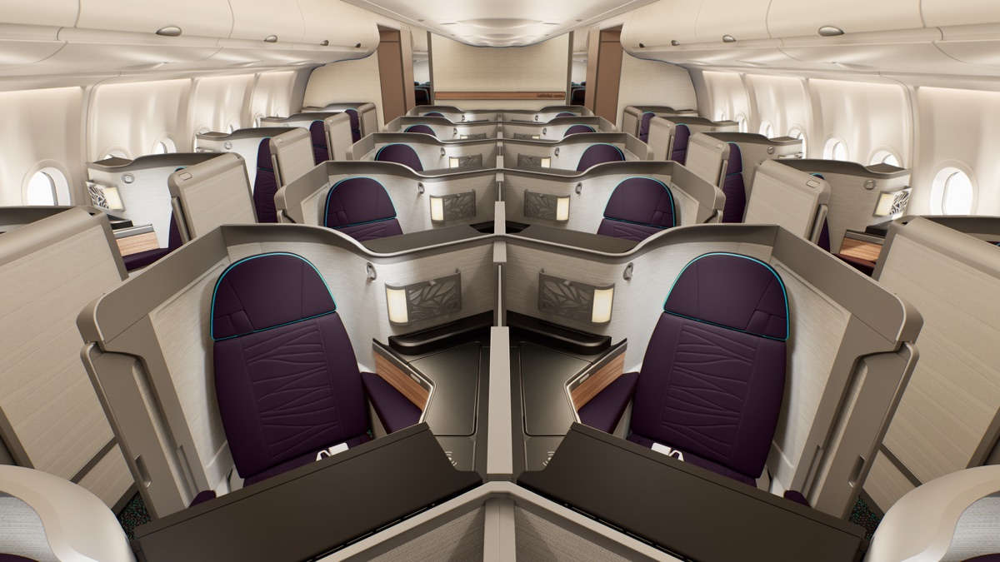
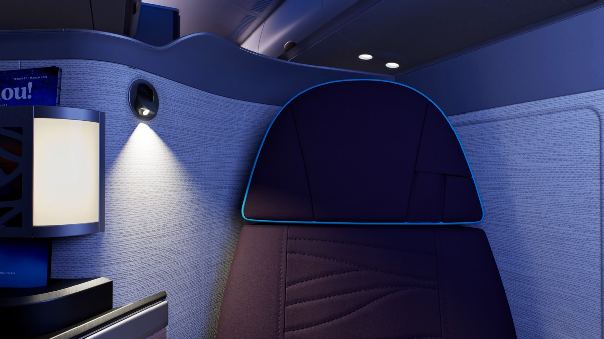
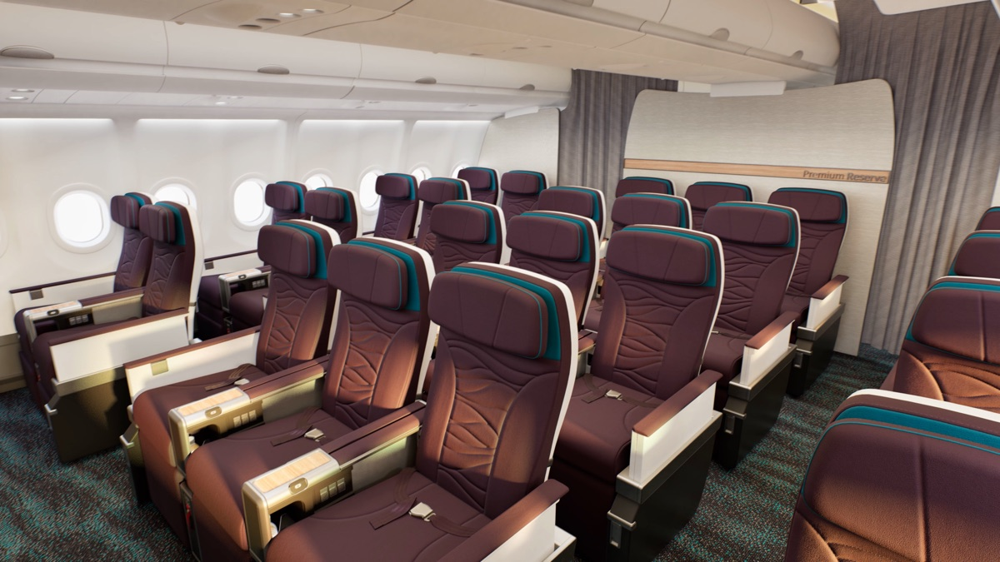

# 夏威夷航空 24 架 A330 全面換新客艙！22 間有門的 Leihōkū 套房、28 席 Premium Reserve，2028 年開始改裝

**新聞分類：航空資訊**
**發布日期：2026 年 11 月 2 日**

**夏威夷航空** 24 架 **A330-200** 將從 **2028 年**開始全面換新客艙：前艙改成 **22 間有滑門的 Leihōkū 套房**，並新增 **28 席 Premium Reserve**。夏威夷航空的 A330 飛**亞洲、大洋洲**與部分北美航線。

*A330 的 Leihōkū 套房採 1-2-1 配置（圖片來源：阿拉斯加航空／夏威夷航空）*

## 一、新舊客艙比一比

| 艙等 | 現在 | 改裝後 |
| --- | --- | --- |
| 商務艙 | 18 席平躺座椅，2-2-2 | **22 間 Leihōkū 套房**，1-2-1，有滑門 |
| Premium Reserve（豪華經濟艙） | 無 | **28 席** |
| 經濟艙 | 260 席（其中 68 席 Premium Class） | 204 席（其中 48 席 Premium Class） |

## 二、各艙等規格

| 艙等 | 規格 |
| --- | --- |
| Leihōkū 套房 | 1-2-1 配置、滑門、19 吋 4K 螢幕、可完全平躺 |
| Premium Reserve | 38 吋座椅間距、16 吋 OLED 觸控螢幕 |
| 經濟艙 | 13 吋 4K OLED 觸控螢幕 |

*Leihōkū 套房（圖片來源：阿拉斯加航空／夏威夷航空）*

### Leihōkū 套房的服務

- **餐飲：** 主廚設計的餐點與餐酒搭配。
- **寢具：** 飯店等級寢具。
- **Wi-Fi：** Starlink Wi-Fi，Atmos Rewards 會員可用。
- **地面服務：** 檀香山、西雅圖有專屬報到與禮賓服務。

*A330 的 Premium Reserve（圖片來源：阿拉斯加航空／夏威夷航空）*

## 三、夏威夷航空機隊的未來

| 機型 | 數量 | 未來 |
| --- | --- | --- |
| A330-200 | 24 架 | 換新客艙 |
| A330-300 貨機 | 11 架 | 繼續當貨機 |
| A321neo | 18 架 | 未定，可能翻倍或全部退役，約 2027～2028 年決定 |
| 717 | 19 架 | 由阿拉斯加航空轉來的 737-800 取代，2028 年開始 |
| 737-800 | 1 架 | 取代 717 |

- **A330 機齡：** 平均約 13.4 年，接近服役中期。
- **A321neo 不改：** 因為去留還沒決定，現在不投資換新客艙。
- **717 退役：** 油耗、維修成本越來越高。

## 四、為什麼改？

夏威夷航空 CEO Diana Birkett Rakow 表示，前艙營收增加，就能減輕後艙票價的壓力。這次改裝讓高端座位變多，也跟阿拉斯加航空集團主打國際航點、高端旅客的方向一致。

## 五、總結

**夏威夷航空 24 架 A330-200 將從 2028 年開始換新客艙：商務艙改成 22 間 1-2-1、有滑門的 Leihōkū 套房，新增 28 席 Premium Reserve，全機換新螢幕，Atmos Rewards 會員可用 Starlink Wi-Fi。** 夏威夷航空的 A330 飛亞洲、大洋洲與部分北美航線，新客艙上線要等 2028 年。

### 消息來源

1. 阿拉斯加航空新聞室：[Press kit: Leihōkū by Hawaiian Airlines – Airbus A330](https://news.alaskaair.com/images-videos/leihoku-by-hawaiian-airlines-airbus-a330/)（2026/9）
2. Simple Flying：[Hawaiian Airlines Is Overhauling The Premium Experience On 24 Airbus A330s](https://simpleflying.com/hawaiian-airlines-overhauling-premium-experience-24-airbus-a330s-isnt-touching-narrowbodies/)（2026/11/2）

_封面照片：夏威夷航空 A330-200（Larry D. Moore／[Wikimedia Commons](https://commons.wikimedia.org/wiki/File:N385HA_Hawaiian_Airlines_Airbus_A330-200_in_2021.jpg)，CC BY 4.0），經裁切。_

_編輯註：本文整理截至 2026 年 11 月 2 日的資訊，以各公司官方公告為準。_
