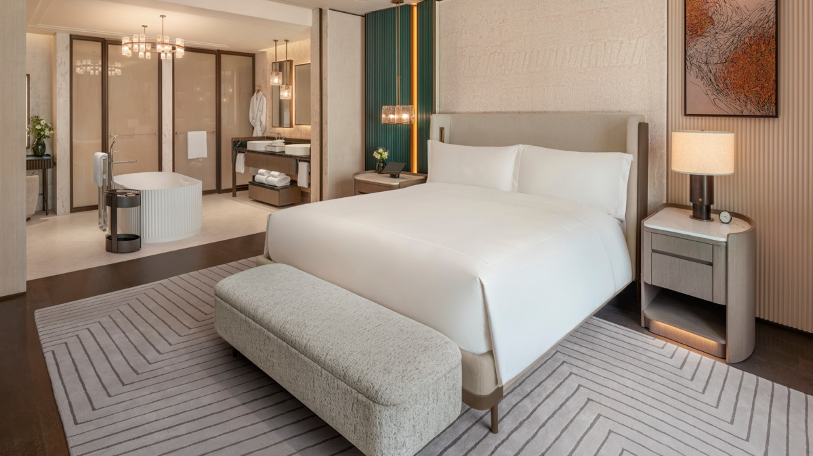
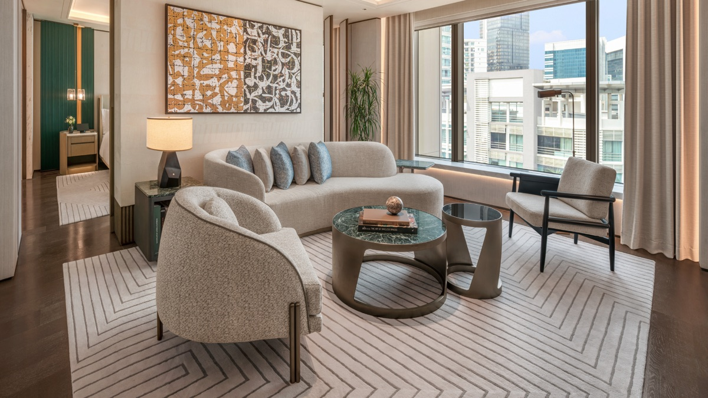
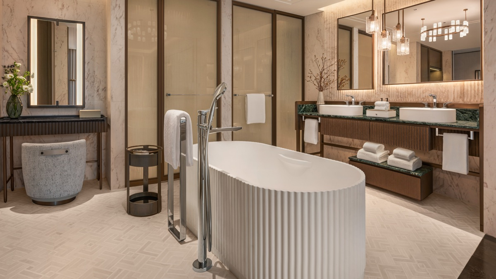
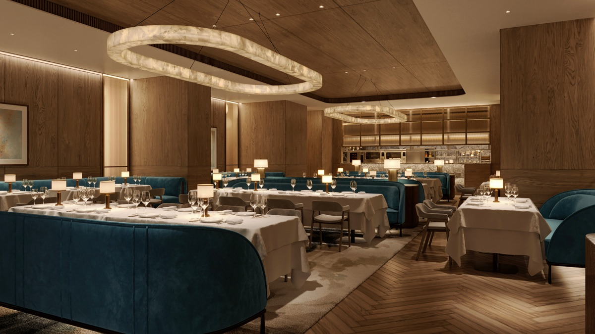

# 吉隆坡華爾道夫開幕！268 間全套房，房價每晚 479 美元起創當地新高，希爾頓點數 10 萬點一晚

**新聞分類：飯店資訊／集團體系**
**發布日期：2026 年 11 月 2 日**

**吉隆坡華爾道夫（Waldorf Astoria Kuala Lumpur）** **10 月 30 日**開幕，是華爾道夫在**馬來西亞的第一家飯店**。全飯店 **268 間全套房**，房價每晚 **479 美元起**，創下吉隆坡飯店價格新高。

## 一、飯店基本資料

| 項目 | 內容 |
| --- | --- |
| 開幕 | 2026 年 10 月 30 日 |
| 地址 | 73, Jalan Raja Chulan, Bukit Bintang, Kuala Lumpur |
| 地段 | 吉隆坡「金三角」 |
| 房間 | 268 間，全部是套房 |
| 套房大小 | 80～745 平方公尺 |
| 水療 | 2,275 平方公尺，La Prairie 療程 |
| 其他設施 | 健身房、戶外游泳池 |

*Signature Suite 臥室（圖片來源：希爾頓）*

*Signature Suite 客廳（圖片來源：希爾頓）*

## 二、房價

| 訂房方式 | 價格 |
| --- | --- |
| 現金最低價 | 每晚 479 美元起（未稅），約新台幣 15,900 元 |
| 現金旺季 | 每晚 600 美元以上（未稅），約新台幣 19,900 元以上 |
| 希爾頓點數 | 標準套房每晚 100,000 點 |

台幣用 Mastercard 匯率 1 美元 ≈ 32.66 元（2026/11/1）換算，含 1.5% 海外刷卡手續費。

### 跟吉隆坡其他頂級飯店比

| 飯店 | 每晚價格 |
| --- | --- |
| 吉隆坡四季 | 約 300 美元 |
| 吉隆坡柏悅 | 約 300 美元 |
| 吉隆坡華爾道夫 | 479 美元起 |

華爾道夫比吉隆坡現有頂級飯店貴五成以上，但最小的套房就有 80 平方公尺，空間是一般頂級飯店客房的兩倍多。

*Signature Suite 浴室（圖片來源：希爾頓）*

## 三、餐廳與酒吧

| 餐廳 | 內容 |
| --- | --- |
| JG KL | 名廚 Jean-Georges Vongerichten 的招牌餐廳 |
| abc kitchens KL | Jean-Georges 的市場食材料理 |
| The Bar by JG | Jean-Georges 酒吧 |
| The Istana | 早餐餐廳 |
| Yaari | 印度料理 |
| Peacock Alley | 華爾道夫招牌酒吧 |

*JG KL 餐廳（圖片來源：希爾頓）*

*戶外游泳池（圖片來源：希爾頓）*

## 四、怎麼訂比較划算？

- **用點數：** 標準套房每晚 10 萬點希爾頓點數，含稅；以每點 0.5 美分估算，等於每晚約 500 美元。
- **付現金：** 透過希爾頓的 Hilton for Luxury 旅行顧問訂房，可以多拿早餐、飯店消費額度、視房況升等等禮遇。
- **想要大空間：** 一家人或想要套房的人，華爾道夫的空間優勢明顯；只想要一般客房的話，吉隆坡柏悅等飯店價格低很多。

## 五、總結

**吉隆坡華爾道夫 10 月 30 日開幕，268 間全套房、最小 80 平方公尺，現金每晚 479 美元起、旺季 600 美元以上，希爾頓點數標準套房每晚 10 萬點。** 價格比吉隆坡四季、柏悅高五成以上，但套房空間大一倍；用希爾頓點數兌換，是體驗這家新飯店的一個選擇。

### 消息來源

1. 希爾頓：[Waldorf Astoria Kuala Lumpur Opens for Reservations Ahead of 30 October 2026 Opening](https://stories.hilton.com/apac/releases/waldorf-astoria-kuala-lumpur-opens-for-reservations)（2026/6/28）
2. One Mile at a Time：[Waldorf Astoria Kuala Lumpur Opens With 268 Suites And Record Pricing](https://onemileatatime.com/news/waldorf-astoria-kuala-lumpur/)（2026/10/31）

_封面照片：吉隆坡華爾道夫外觀（圖片來源：希爾頓）_

_編輯註：本文整理截至 2026 年 11 月 2 日的資訊，以各公司官方公告為準。_
