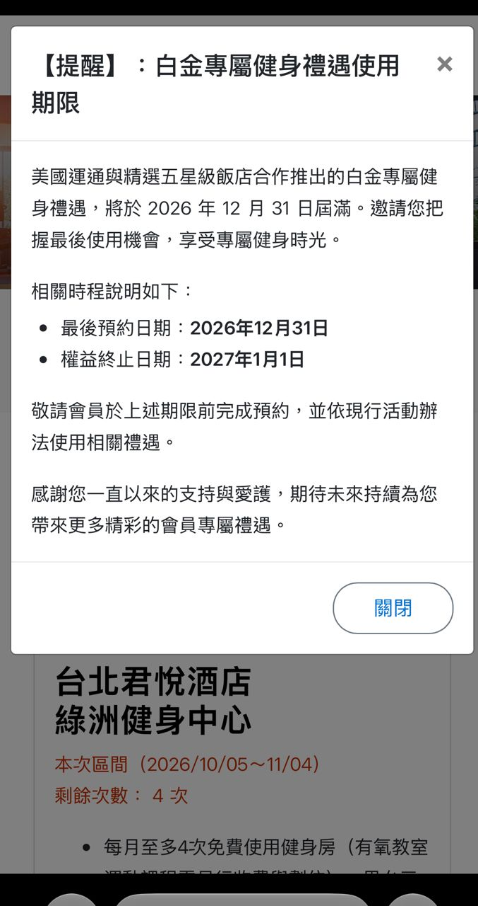

# 美國運通簽帳白金卡「白金專屬健身禮遇」12/31 屆滿！君悅、漢來、遠東香格里拉等 6 間五星飯店健身房 2027 年起不能用

**新聞分類：信用卡／台灣信用卡**
**發布日期：2026 年 11 月 4 日**

**台灣美國運通簽帳白金卡**的「**白金專屬健身禮遇**」確定在 **2026 年 12 月 31 日屆滿**。預約網站已經跳出公告：**最後預約日是 2026/12/31，2027/1/1 起權益終止**。這項權益可以免費使用台北君悅、台北漢來、遠東香格里拉等 6 間五星級飯店的健身房、泳池和三溫暖，是白金卡很有感的權益之一。

*白金專屬健身禮遇預約網站上的屆滿公告（圖片來源：PTT 網友截圖）*

## 一、屆滿時程

| 項目 | 日期 |
| --- | --- |
| 本年度優惠期間 | 2026/1/1～2026/12/31 |
| **最後預約日** | **2026/12/31** |
| **權益終止日** | **2027/1/1** |
| 2027 年 | 目前沒有公告替代方案 |

## 二、現在的使用規則

| 項目 | 內容 |
| --- | --- |
| 適用 | 簽帳白金卡**主卡**會員 |
| 費用 | 免入會費、清潔費、月費 |
| 次數 | 每月每間最多 **4 次**免費入場（每日名額有限） |
| 預約開放 | 每月 **5 日 00:00**（台灣時間）開放 |
| 預約區間 | 當月 5 日到次月 4 日，區間內限預訂 4 次，單日限預約 1 間 |
| 登入方式 | 身分證後 6 碼＋西元出生年月 6 碼 |
| 報到 | 出示簽帳白金卡主卡、電子優惠券、有照片的身分證件 |
| 遲到 | 要在預約時段內到場，逾時無法入場 |

## 三、6 間合作健身房

| 飯店 | 包含設施 | 時間限制 | 停車 | 其他 |
| --- | --- | --- | --- | --- |
| **台北君悅酒店** 綠洲健身中心 | 健身房、男女三溫暖、戶外溫水泳池 | 3 小時，不可中途離場 | 免費 3 小時 | 逾時 1 小時內收 700 元、超過 1 小時 1,500 元；有氧課每次 350 元 |
| **台北漢來大飯店** 健身中心 | 健身房、露天泳池、三溫暖 | 3 小時 | 免費 3 小時 | 逾時可付 1,800 元（當日來賓費）續用；連假、大型展會等日期不適用 |
| **台北遠東香格里拉** 遠東健身俱樂部 | 三溫暖（桑拿、蒸氣、按摩浴）、健身房、泳池 | 3 小時 | 不含 | 逾時付 1,200 元（當日來賓費）；週二到週五另有美國運通貴賓日優惠 |
| **台北美麗信花園酒店** 活力健身俱樂部 | 有氧、重量訓練、戶外溫水泳池、桑拿 | 3 小時 | 不含 | 每月第一個星期一保養 |
| **長榮桂冠酒店（台中）** 健身中心 | 健身中心、露天泳池 | 3 小時 | 免費 2 小時 | 迴力球場、SPA 需自費 |
| **寒軒國際大飯店（高雄）** 商務休閒中心 | 健身區、三溫暖、游泳池、商務中心 | 3 小時 | 不含 | 每月 2 次設備維修日 |

### 地址與電話

| 飯店 | 地址 | 電話 |
| --- | --- | --- |
| 台北君悅 | 台北市信義區松壽路 2 號 5 樓 | (02)2720-1234 |
| 台北漢來 | 台北市南港區經貿一路 168 號 | (02)2788-6866 |
| 台北遠東香格里拉 | 台北市大安區敦化南路二段 201 號 6 樓 | (02)7700-3071 |
| 台北美麗信 | 台北市中山區市民大道三段 83 號 2 樓 | (02)7702-8800 分機 2255 |
| 長榮桂冠（台中） | 台中市西屯區台灣大道二段 666 號 B1 | (04)2313-9988 |
| 寒軒（高雄） | 高雄市苓雅區四維三路 33 號 7 樓 | (07)332-2000 |

## 四、這項權益值多少錢

以飯店公告的當日來賓費估算：

| 飯店 | 當日來賓費 | 每月用滿 4 次約等於 |
| --- | --- | --- |
| 台北遠東香格里拉 | 1,200 元 | 4,800 元 |
| 台北漢來 | 1,800 元 | 7,200 元 |

常去健身的人，一年下來價值可以到數萬元，取消後白金卡的整體價值會打折扣。

## 五、剩下還能用幾次

| 預約區間 | 開放預約 | 說明 |
| --- | --- | --- |
| 11/5～12/4 | 11/5 00:00 | 本區間 4 次 |
| 12/5～12/31 | 12/5 00:00 | **最後一個區間**，只到 12/31 |

想用的人建議 11/5、12/5 凌晨開放時就先預約，熱門時段很難搶。

## 六、總結

**美國運通簽帳白金卡的白金專屬健身禮遇 2026/12/31 屆滿，2027/1/1 起終止，台北君悅、漢來、遠東香格里拉、美麗信、台中長榮桂冠、高雄寒軒 6 間健身房都不能再免費使用。** 剩下兩個預約區間，有在用的人記得把握；續卡前也可以重新評估白金卡的價值。

### 消息來源

1. 台灣美國運通：[白金專屬健身禮遇](https://www.americanexpress.com/zh-tw/benefits/annual/rcp-platinum/lifestyle.gym.html)
2. PTT 信用卡板：[[情報] AE簽帳白金健身房權益 2027砍掉！](https://www.ptt.cc/bbs/creditcard/M.1793597679.A.8F5.html)（2026/11/2）

_封面照片：台北君悅酒店（Johan Jönsson／[Wikimedia Commons](https://commons.wikimedia.org/wiki/File:Grand_Hyatt_Taipei_left_side_20230808.jpg)，CC BY-SA 4.0），經裁切。_

_編輯註：本文整理截至 2026 年 11 月 4 日的資訊，以各公司官方公告為準。_
