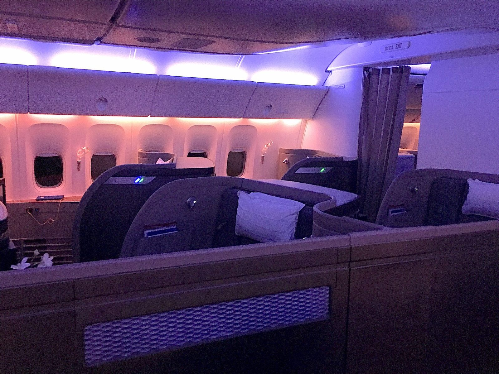
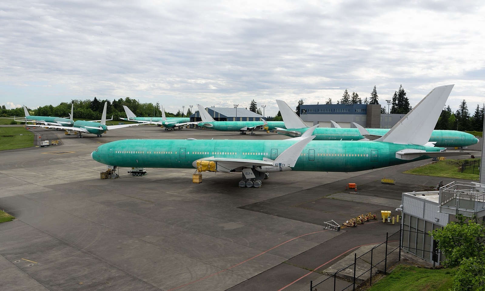

# 國泰新頭等艙「Halo Suites」曝光！只裝在 777-9、最快 2027 年底，專利圖可變雙人套房；現有頭等艙只剩 6 架

**新聞分類：航空資訊／寰宇一家**
**發布日期：2026 年 11 月 4 日**

**國泰航空**的新頭等艙終於有了名字：**「The Halo Suites」**。國泰早在 2023 年就為新商務艙「Aria Suites」和新頭等艙「Halo Suites」申請商標，Aria Suites 已經在 777-300ER 上陸續啟用，Halo Suites 則要等 **777-9** 交機，**最快 2027 年底、更可能是 2028 年**。

## 一、目前知道的 Halo Suites

| 項目 | 內容 |
| --- | --- |
| 名稱 | **The Halo Suites**（2023 年申請商標，用於「豪華及頭等艙航空運輸服務」） |
| 機型 | **只裝在 777-9**，不會裝在 777-300ER |
| 777-9 訂單 | **35 架** |
| 有頭等艙的架數 | 預估約 **20 架** |
| 其他 777-9 | 商務、豪華經濟、經濟三艙 |
| 原定交機 | 2020 年 |
| 目前時程 | 777-9 最快 **2027 年下半年**投入商業飛行；國泰不是首家客戶，可能要到 **2028 年** |
| 外觀曝光 | 傳聞未來幾個月內會有首次預告，國泰尚未公布官方圖片 |

*國泰航空現役 777-300ER 頭等艙（Raymondeuro／Wikimedia Commons，CC BY-SA 4.0）*

## 二、專利圖透露的設計

國泰 2019 年申請過一項頭等艙專利，不保證就是 Halo Suites，但很可能是設計方向：

| 設計 | 內容 |
| --- | --- |
| 走道 | 頭等艙**只有一條走道**，讓每間套房更寬 |
| 座位數 | 777-9 頭等艙 **4 席** |
| 雙人套房 | 兩間相鄰套房可以**合併成一個共用空間** |
| 家庭模式 | 可加一個**上鋪**，讓一家人同住一間（不是標準配備） |
| 私人洗手間 | 雙人套房可透過移動隔板，在右側隔出**專屬洗手間** |

這個概念和設計公司 PaperClip Design 的「Peacock Suites」很接近。前董事長賀以禮曾形容新產品「令人驚豔」。

## 三、現役頭等艙越來越少

| 項目 | 內容 |
| --- | --- |
| 777-300ER 改裝 | 換上新 **Aria Suites** 商務艙，同時**拆掉頭等艙** |
| 改裝後配置 | 多數為商務、豪華經濟、經濟三艙，少數保留四艙 |
| 目前有頭等艙 | **只剩 6 架** |
| 可能做法 | 國泰曾表示可能暫緩改裝部分飛機，保留少量頭等艙給需求高的航線 |

777-9 一再延誤，加上現有頭等艙越拆越少，未來兩年國泰頭等艙會比以前更難訂。

*停放在美國 Paine Field 的波音 777X，交機時程一再延後（Quintin Soloviev／Wikimedia Commons，CC BY 4.0）*

## 四、國泰 1,500 億港元投資計畫

國泰在 2026 年中期業績公布的長期計畫，也是 Halo Suites 的背景：

| 項目 | 內容 |
| --- | --- |
| 投資金額 | 約 **1,500 億港元** |
| 用途 | 機隊、客艙、貴賓室、數位創新 |
| 新飛機 | 未來 10 年接收 **150 架**以上，已落實訂單約 100 架 |
| 航點目標 | **150 個**（目前約 103 個） |
| 新機型 | A330-900、777-9、A350F 貨機等 |
| 貴賓室 | 香港 The Wing、東京成田貴賓室 2027 年改裝 |
| 2026 上半年 | 股東應占溢利 62 億港元（去年同期 37 億） |

## 五、各家新頭等艙比較

| 航空 | 新頭等艙 | 時程 |
| --- | --- | --- |
| 國泰航空 | Halo Suites（777-9） | 最快 2027 年底 |
| 法國航空 | 777 La Première 新套房 | 已上線，詳見[法航 La Première](/air-france-la-premiere-first-class-2026) |
| 新加坡航空 | A350 新頭等、商務艙 | 11/6 亮相，2027 年第一季啟用 |
| 卡達航空 | 新頭等艙 | 未定，詳見[卡達新頭等艙從確定變未定](/qatar-airways-new-first-class-uncertain-2026) |

## 六、總結

**國泰新頭等艙預計叫「The Halo Suites」，只會裝在 777-9，最快 2027 年底、可能 2028 年才看得到；專利圖顯示單走道、每架 4 席、可合併成雙人套房。** 在那之前，國泰只剩 6 架飛機有頭等艙，想用哩程換國泰頭等艙的人要更早規劃。

### 消息來源

1. One Mile at a Time：[New Cathay Pacific "Halo Suites" First Class For Boeing 777-9s](https://onemileatatime.com/news/new-cathay-pacific-first-class/)（2026/11/3）
2. Aviation24.be：[Cathay Group doubles first half profit, announces dividend and targets 150 aircraft expansion](https://www.aviation24.be/airlines/cathay-pacific/cathay-group-doubles-first-half-profit-announces-dividend-and-targets-150-aircraft-expansion/amp/)（2026/8）
3. 香港01：[國泰豪洗1500億拓機隊](https://www.hk01.com/財經快訊/60377188/國泰豪洗1500億拓機隊-稱票價策略切合供需-今年將聘3000人)（2026/8）

_封面照片：國泰航空 777-300ER 在香港機場（N509FZ／[Wikimedia Commons](https://commons.wikimedia.org/wiki/File:Cathay_Pacific_B777-300ER_(B-KQV)_@_HKG,_March_2019.jpg)，CC BY-SA 4.0），經裁切。_

_編輯註：本文整理截至 2026 年 11 月 4 日的資訊，以各公司官方公告為準。_
