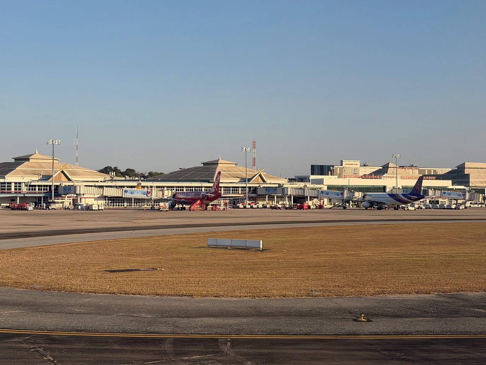

# 清邁天燈節 8 天取消 108 個航班！台灣直飛 4 家航空 11/24、11/25 改時間一覽：華航、長榮延後近 2 小時，泰亞航提前 5 小時

**新聞分類：航空資訊／無聯盟**
**發布日期：2026 年 11 月 4 日**

泰國**清邁天燈節（Yi Peng）**與水燈節 **11 月 24 日至 25 日**登場，預估超過 **20 萬盞天燈**升空。為了避免天燈飄進起降航道，**清邁國際機場**在 **11 月 21 日到 28 日**共取消 **108 個航班**、**80 班改時間**、另加開 **105 班**。台灣直飛清邁的 **4 家航空**也有班機改時間，以下逐班整理。

## 一、清邁機場異動總覽

| 項目 | 內容 |
| --- | --- |
| 天燈節日期 | **2026/11/24～11/25** |
| 預估天燈數 | 超過 **20 萬盞**（天燈與煙燈） |
| 異動期間 | **11/21～11/28**，共 8 天 |
| 取消航班 | **108 班** |
| 改時間 | **80 班** |
| 加開特別航班 | **105 班** |
| 合計受影響 | **293 班** |
| 機場每日運作時間 | 從約 20 小時縮短到約 **12 小時** |
| 節慶期間每日航班 | 約 210 班，最多 232 班，比平常多約 10% |

取消並不代表機場關閉，大部分航班仍照常或改時間飛。

## 二、禁止起降的時段

| 日期 | 泰國時間 | 台灣時間 |
| --- | --- | --- |
| 11/24（二） | **10:00～12:00** | 11:00～13:00 |
| 11/24（二）晚上 | **19:00～11/25 01:00** | 20:00～11/25 02:00 |
| 11/25（三）晚上 | **19:00～11/26 01:00** | 20:00～11/26 02:00 |

航空公司必須避開這三個時段安排在清邁的起降。

## 三、台灣直飛清邁的 4 家航空（平常班表）

| 航空 | 班號 | 去程 桃園→清邁 | 回程 清邁→桃園 | 機型 |
| --- | --- | --- | --- | --- |
| 中華航空 | CI851／852 | 07:20 → 10:25 | 11:25 → 15:55 | A321neo |
| 長榮航空 | BR257／258 | 07:30 → 10:35 | 11:50 → 16:20 | A321 |
| 星宇航空 | JX751／752 | 13:05 → 16:00 | 17:15 → 21:45 | A321neo |
| 泰國亞洲航空 | FD243／242 | 18:55 → 22:00 | 隔天 01:40 → 06:15 | A320neo |

*桃園時間為台灣時間，清邁時間為泰國時間（比台灣慢 1 小時）。*

**哪些會撞到限制時段：**

- 華航、長榮平常 **10:25、10:35 抵達清邁**，回程 **11:25、11:50 起飛**，都落在 11/24 上午 10:00～12:00。
- 泰亞航平常 **22:00 抵達清邁**，落在 11/24、11/25 晚上 19:00～01:00。
- 星宇 16:00 抵達、17:15 起飛，**不受影響**。

*清邁國際機場（Setawut／Wikimedia Commons，CC BY-SA 4.0）*

## 四、11/24（二）台灣航班異動

### 去程 桃園→清邁

| 航空 | 平常 | 11/24 | 變化 |
| --- | --- | --- | --- |
| 中華航空 | 07:20 → 10:25 | **09:05 → 12:10** | 延後 1 小時 45 分 |
| 長榮航空 | 07:30 → 10:35 | **09:10 → 12:15** | 延後 1 小時 40 分 |
| 星宇航空 | 13:05 → 16:00 | 13:05 → 16:00 | 不變 |
| 泰國亞洲航空 | 18:55 → 22:00 | **13:40 → 16:50** | **提前 5 小時 15 分** |

### 回程 清邁→桃園

| 航空 | 平常 | 11/24 | 變化 |
| --- | --- | --- | --- |
| 中華航空 | 11:25 → 15:55 | **13:10 → 17:40** | 延後 1 小時 45 分 |
| 長榮航空 | 11:50 → 16:20 | **13:25 → 17:55** | 延後 1 小時 35 分 |
| 星宇航空 | 17:15 → 21:45 | 17:15 → 21:45 | 不變 |
| 泰國亞洲航空 | 凌晨 01:40 → 06:15 | **08:00 → 12:40** | 改成早上起飛 |

## 五、11/25（三）台灣航班異動

### 去程 桃園→清邁

| 航空 | 11/25 | 變化 |
| --- | --- | --- |
| 中華航空 | 07:20 → 10:25 | 不變（上午沒有限制） |
| 長榮航空 | 07:30 → 10:35 | 不變 |
| 星宇航空 | 13:05 → 16:00 | 不變 |
| 泰國亞洲航空 | **13:40 → 16:50** | **提前 5 小時 15 分**（避開晚上限制） |

### 回程 清邁→桃園

| 航空 | 11/25 |
| --- | --- |
| 泰國亞洲航空 | **08:00 → 12:40**（改成早上起飛） |
| 中華、長榮、星宇 | 查詢時沒有顯示可訂座位，可能已客滿，請以航空公司通知為準 |

**11/26（四）回程：** 泰亞航恢復凌晨 01:40 起飛，星宇 17:15 照常。

*以上為 2026/11/4 在訂位系統查到的時刻，航空公司仍可能再調整。*

## 六、目前看到的重點

| 航空 | 11/24～25 狀況 |
| --- | --- |
| 中華航空 | 11/24 去回程延後約 1 小時 45 分 |
| 長榮航空 | 11/24 去回程延後約 1 小時 40 分 |
| 星宇航空 | 時間不變 |
| 泰國亞洲航空 | 11/24、11/25 去程從晚上改成下午，回程從凌晨改成早上 |

目前查到的台灣直飛航班都是**改時間**，還沒有看到整班取消。

## 七、有訂這幾天機票的人該怎麼做

1. **到航空公司官網或 App 查訂位紀錄**，確認新的起飛時間；改時間通常會寄信或簡訊通知。
2. **改時間不能接受**：可以聯絡航空公司或旅行社，詢問免費改期或退票。
3. **檢查後續行程**：飯店入住、機場接送、包車、轉機（例如經曼谷轉國內線）都要跟著調整。
4. **提早到機場**：清邁機場建議國際線提前 **3 小時**、國內線 2 小時到；節慶期間人潮多，建議用線上報到。
5. **經曼谷轉機的人**：曼谷－清邁國內線受影響最大，轉機時間要留寬一點。

## 八、天燈施放規定

| 規定 | 內容 |
| --- | --- |
| 航道下方 | 第一級特別監控「紅色區域」**全面禁止施放** |
| 違規處罰 | 最高 **5 年有期徒刑**、**20 萬泰銖罰款**，或兩者併罰 |
| 機場措施 | 增加跑道巡查，清除天燈殘骸 |

## 九、總結

**清邁天燈節 11/21～28 取消 108 個航班，限制時段集中在 11/24 上午和 11/24、11/25 晚上。台灣直飛的華航、長榮 11/24 去回程延後約 1 小時 40 分，泰亞航 11/24、11/25 去程從晚上改到下午，星宇時間不變。** 有訂這幾天機票的人，請盡快確認新時間，並調整飯店與接送。

### 消息來源

1. CTWANT：[台灣人赴泰注意！清邁天燈節8天取消108航班　4家直飛航空受關注](https://www.ctwant.com/article/505117/)（2026/11/3）
2. TVBS 新聞網：[飛泰國清邁注意！迎天燈節「108航班取消」 影響時間曝光](https://news.tvbs.com.tw/world/4045304)（2026/11/3）
3. The Thaiger：[Airlines cancel 108 Chiang Mai flights to avoid Yi Peng lanterns](https://thethaiger.com/news/chiang-mai/airlines-cancel-108-chiang-mai-flights-to-avoid-yi-peng-lanterns)（2026/11/3）
4. Khaosod English：[200,000 lanterns: Chiang Mai cancels 108 flights for Yi Peng lantern festival](https://www.khaosodenglish.com/news/2026/11/03/200000-lanterns-chiang-mai-cancels-108-flights-for-yi-peng-lantern-festival/)（2026/11/3）
5. 航班時刻：FlightAware、Google 航班（2026/11/4 查詢）

_封面照片：清邁天燈節的天燈（Nik Cyclist／[Wikimedia Commons](https://commons.wikimedia.org/wiki/File:Yi_Peng_lanterns_in_Chiang_Mai_(11067469754).jpg)，CC BY 2.0），經裁切。_

_編輯註：本文整理截至 2026 年 11 月 4 日的資訊，以各公司官方公告為準。_
