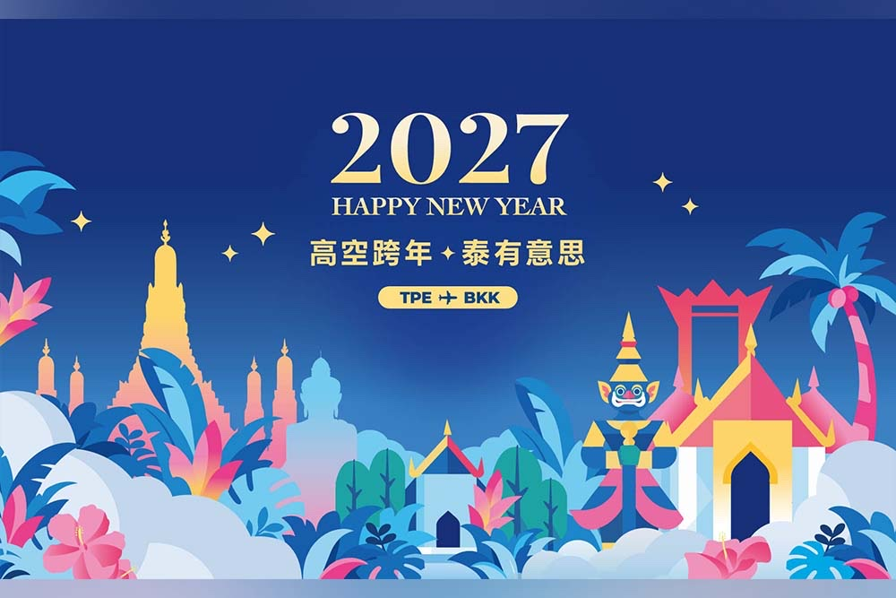
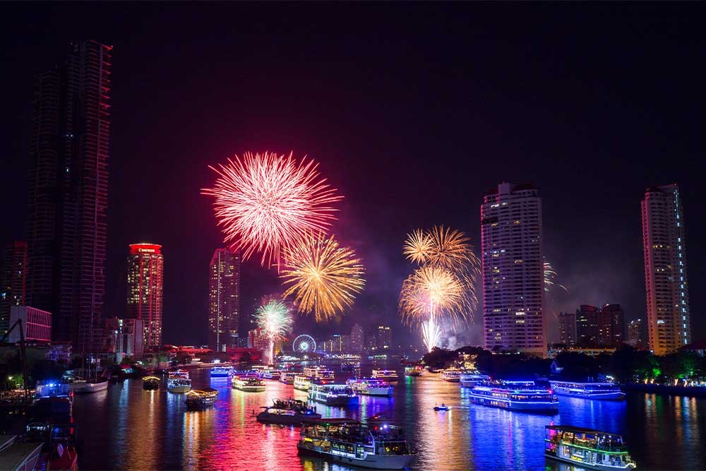
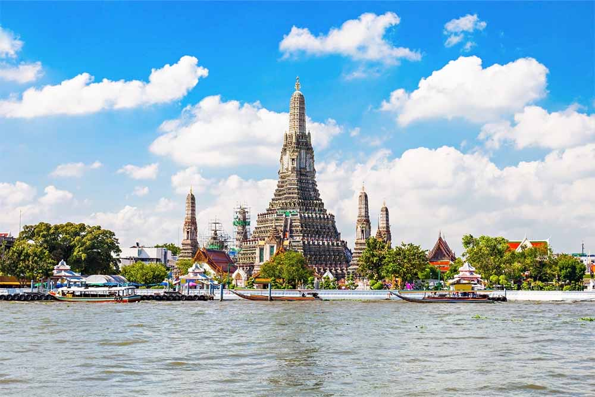

# 華航首推跨年主題航班！12/31 台北飛曼谷 CI837 在高空迎 2027，經濟艙單程 1 萬元、11/5 上午 10 點開賣

**新聞分類：航空資訊／天合聯盟**
**發布日期：2026 年 11 月 4 日**

**中華航空**首度推出跨年主題航班「**高空跨年 泰有意思**」：**12 月 31 日**搭乘台北飛曼谷的 **CI837**，在萬呎高空迎接 2027 年。經濟艙單程 **10,000 元**（未稅），**11 月 5 日上午 10 點**在華航官網和 App 開賣。

*「高空跨年 泰有意思」主題航班主視覺（圖片來源：中華航空）*

## 一、航班資訊

| 項目 | 內容 |
| --- | --- |
| 活動名稱 | 高空跨年 泰有意思 |
| 日期 | **2026 年 12 月 31 日** |
| 航班 | **CI837 台北（桃園）→ 曼谷** |
| 機型 | **A321neo** |
| 經濟艙 | 單程 **10,000 元**（未稅） |
| 豪華商務艙 | 單程 **17,600 元**（未稅） |
| 回程 | 依行程**自由安排**航班 |
| 開賣 | **11 月 5 日上午 10:00**，華航官網及 App |

### 什麼時候跨年

| 項目 | 時間 |
| --- | --- |
| CI837 平常起飛 | 桃園 **22:30**（台灣時間） |
| 平常抵達 | 曼谷 **01:14**（泰國時間） |
| 飛行時間 | 約 3 小時 45 分 |
| 台灣時間零點 | 起飛後約 1.5 小時，**在空中** |
| 泰國時間零點（台灣 01:00） | 降落前約 1 小時，**也在空中** |

*依目前班表推算，12/31 實際時刻以訂位顯示為準。*

## 二、出發前：送機與好禮

| 項目 | 內容 |
| --- | --- |
| 送機 | **Uber 千元折抵**送機優惠 |
| 紀念品 | 泰國觀光局大象鑰匙圈 |
| 聯名小物 | Aroma Teddy 聯名限定新年小熊盲盒 |
| 上網 | **KLOOK eSIM** 免費 3 日不限流量 |

## 三、機上：慶祝活動與餐點

| 項目 | 內容 |
| --- | --- |
| 慶祝 | 空中跨年慶祝活動 |
| 紀念 | 專屬**跨年證書** |
| 餐點（全艙等） | 燒肉專門店「大腕燒肉」 |
| 經濟艙 | 南洋烤雞腿排飯 |
| 甜點飲品 | 跨年航班專屬設計 |
| 抽獎 | 華航哩程、**皮卡丘彩繪機 CI2 模型機**、周邊商品 |

*曼谷跨年煙火（圖片來源：中華航空）*

## 四、抵達曼谷：還有這些

| 項目 | 內容 |
| --- | --- |
| 交通 | 免費 **曼谷 BTS 交通卡** |
| 伴手 | 泰國手標茶 ChaTraMue |
| SPA | Divana SPA 優惠價 |
| 住宿 | 「華航好哩宿」指定飯店可用**哩程折抵房費** |
| 行程 | KLOOK 行程折扣 |
| 其他 | 憑登機證到指定餐廳、飯店有優惠 |

*曼谷鄭王廟（圖片來源：中華航空）*

*泰式料理（圖片來源：中華航空）*

## 五、要注意

- **票價未稅**：1 萬元、1 萬 7,600 元都不含稅金與燃油附加費；國籍航空 11/8 起燃油附加費亞洲短程每段 40 美元，詳見[燃油附加費 11/8 起連 4 漲](/taiwan-fuel-surcharge-november-2026)。
- **凌晨抵達**：依目前班表凌晨 1 點多抵達曼谷，記得先安排機場到飯店的交通與入住。
- **入境泰國**：入境前要先上網填寫泰國數位入境卡（TDAC）。
- **只有一班**：主題航班只有 12/31 這一班，想搭的人 11/5 上午 10 點準時上線。

## 六、總結

**華航首推跨年主題航班，12/31 台北飛曼谷 CI837，經濟艙單程 1 萬元、豪華商務艙 1 萬 7,600 元（未稅），11/5 上午 10 點開賣；從 Uber 送機、機上跨年證書到曼谷 BTS 交通卡都有送。** 依目前班表，台灣和泰國的零點都會在空中度過，想換個方式跨年的人可以把握。

### 消息來源

1. 自由時報：[華航首推「跨年航班」飛曼谷單程1萬元起 明上午10點起開賣](https://news.ltn.com.tw/news/life/breakingnews/5629119)（2026/11/4）
2. 鉅亨網：[華航首推跨年主題航班 打造全旅程限定企劃](https://news.cnyes.com/news/id/6646105)（2026/11/4）
3. 旅報：[單程1萬元飛曼谷跨年 華航首推跨年航班11/5開賣](https://www.ttnmedia.com/?p=144692)（2026/11/4）
4. 航班時刻：FlightAware（2026/11/4 查詢）

_封面照片：華航 A321neo 在桃園機場滑行（4300streetcar／[Wikimedia Commons](https://commons.wikimedia.org/wiki/File:China_Airlines_Airbus_A321neo_and_Boeing_777F_taxiing_at_Taoyuan_February_2026.jpg)，CC BY 4.0），經裁切。_

_編輯註：本文整理截至 2026 年 11 月 4 日的資訊，以各公司官方公告為準。_
