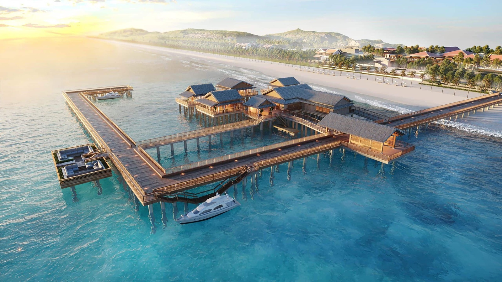
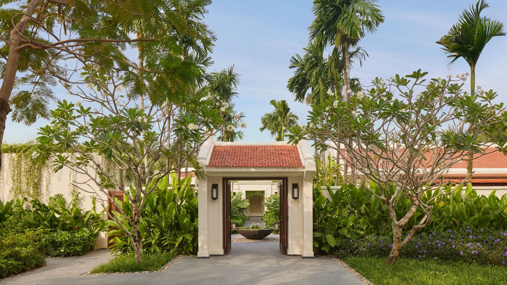
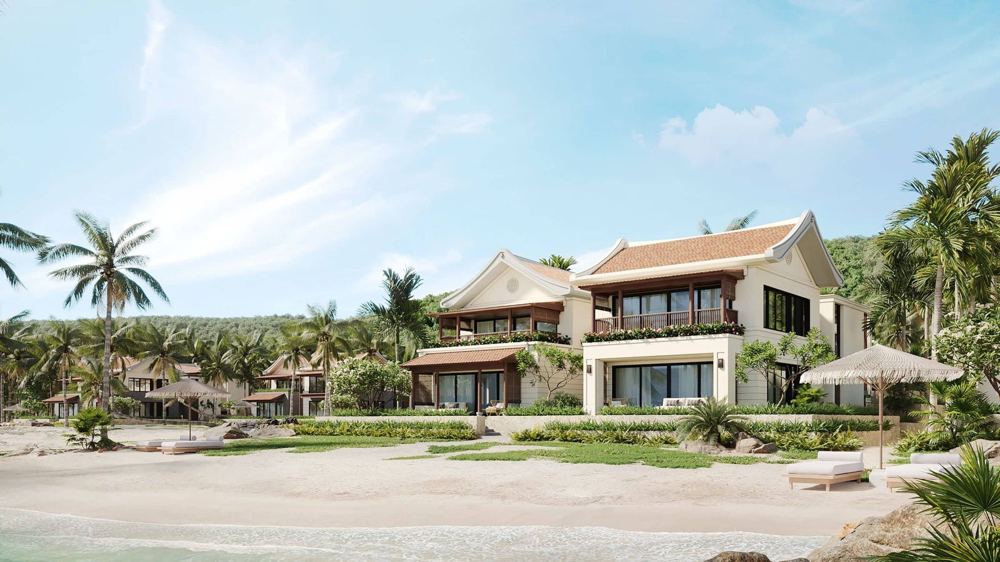
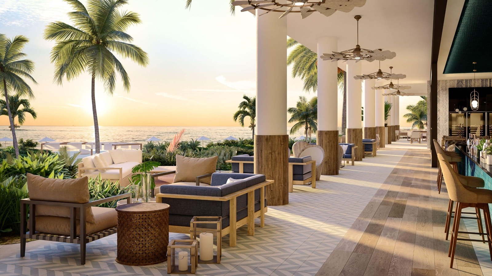
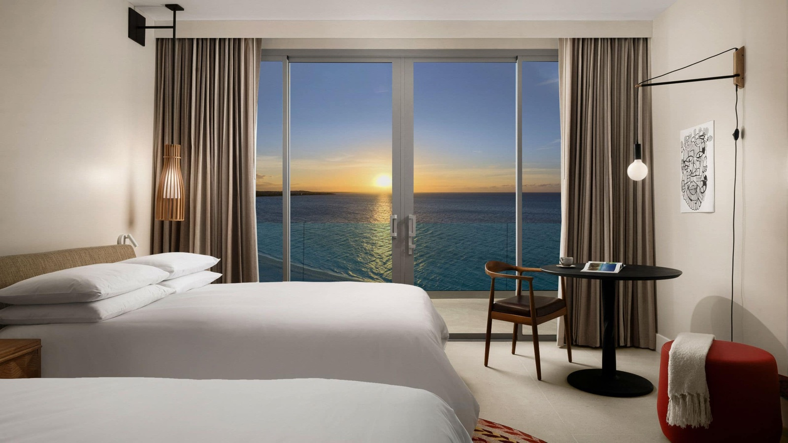
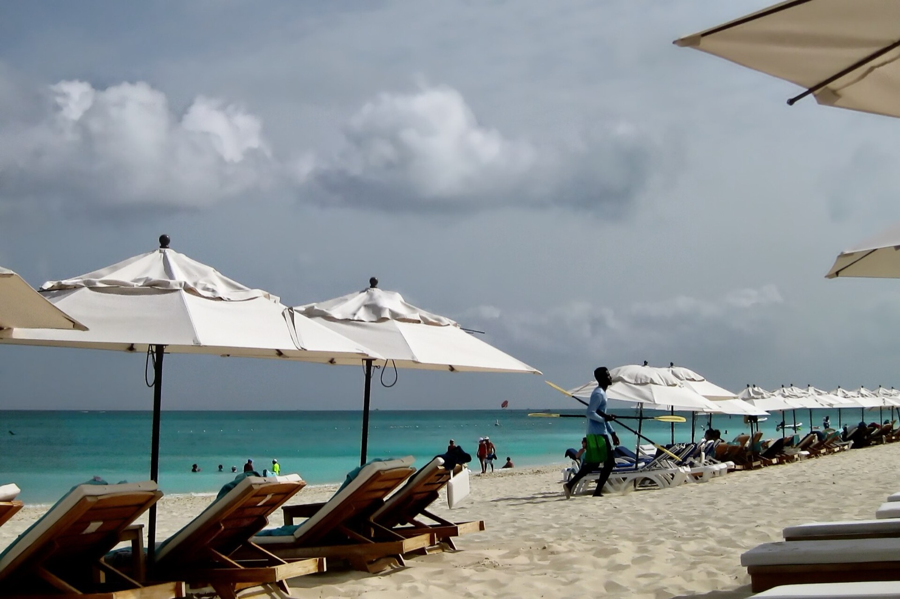

# 越南富國島柏悅 12/8 開幕！5 年延誤終於開放預訂，入門房就有 80 平方公尺；凱悅加勒比海首間 Andaz 2027 年 4 月登場

**新聞分類：飯店資訊／集團體系**
**發布日期：2026 年 11 月 4 日**

延宕多年的**越南富國島柏悅（Park Hyatt Phu Quoc）**終於有好消息：飯店開放 **2026 年 12 月 8 日**起的訂房，比原本的 2027 年 3 月**提前**，再過幾週就開幕。同一時間，凱悅首間**加勒比海 Andaz**「**Andaz 特克斯與凱科斯**」也開放 2027 年 4 月起的訂房。

## 一、富國島柏悅基本資料

| 項目 | 內容 |
| --- | --- |
| 開幕（可訂日期） | **2026 年 12 月 8 日** |
| 時程 | 2019 年宣布，原定 2022 年開幕，延誤 4 年多 |
| 地位 | 越南**第一間柏悅度假村**；越南第二間柏悅（另一間是西貢柏悅） |
| 位置 | 富國島西南端，佔地 160 英畝，一邊是約 1.6 公里白沙灘、一邊是山丘 |
| 交通 | 距富國國際機場（PQC）約 **30 分鐘車程** |
| 房間數 | **168 間**：114 間客房與套房＋**54 棟私人泳池別墅** |
| 凱悅類別 | **第 7 類** |

*富國島柏悅碼頭與海灘鳥瞰示意圖（圖片來源：凱悅）*

## 二、房型大小

| 房型 | 面積起 |
| --- | --- |
| 入門客房 | **80 平方公尺**（861 平方英尺） |
| 套房 | **165 平方公尺**（1,776 平方英尺） |
| 別墅 | **280 平方公尺**（3,013 平方英尺） |
| The Manor | 8 房海景別墅，最多 24 人，每晚 25,000 美元以上 |

*面積可能包含戶外空間。*

*富國島柏悅別墅入口（圖片來源：凱悅）*

## 三、設施

| 類別 | 內容 |
| --- | --- |
| 餐廳 | Fisherman's（越南海鮮）、Pepper Grill（明火料理）、Herbs & Spices（越南家常菜）、La Maisonette（法式越南菜）、Pool House & Bar（義大利菜）、The Living Room（大廳酒吧） |
| 泳池 | 2 座 |
| SPA | 湖畔 SPA |
| 健身 | 健身館＋標準泳道泳池 |
| 其他 | 兒童俱樂部、宴會空間 |

*富國島柏悅客房外觀示意圖（圖片來源：凱悅）*

## 四、點數與現金價

| 項目 | 內容 |
| --- | --- |
| 點數 | 第 7 類，每晚 **25,000～55,000 點** |
| 現金 | 約 **700 美元起**，另加 13.4% 稅費與服務費，含稅超過 **800 美元**（約新台幣 2.6 萬元） |
| 新飯店加碼 | 名列凱悅新飯店雙倍點數名單 |

*以 Mastercard 11/2 匯率 1 美元 ≈ 32.63 元換算。*

付現入住的話，可以考慮透過 Hyatt Privé 旅遊顧問預訂，加送升等、飯店消費額度等禮遇。

## 五、台灣怎麼去富國島

| 方式 | 說明 |
| --- | --- |
| 台中直飛 | 星宇航空有台中－富國島航線 |
| 轉機 | 經胡志明市約 1 小時國內線 |

富國島目前評價高的飯店還有 JW 萬豪、洲際、麗晶，柏悅加入後選擇更多。

## 六、Andaz 特克斯與凱科斯

| 項目 | 內容 |
| --- | --- |
| 開幕（可訂日期） | **2027 年 4 月 1 日** |
| 地位 | 凱悅在特克斯與凱科斯的**第一間**、**第一間加勒比海 Andaz** |
| 時程 | 2018 年宣布、原定 2021 年，延誤 6 年 |
| 位置 | 格蕾絲灣（Grace Bay）海灘第一排 |
| 規模 | 5.5 英畝；**59 間客房**＋73 間品牌住宅 |
| 餐飲 | Tamarà（全日餐廳）、Baie（池畔餐廳酒吧）、Palmette（咖啡廳）、大廳酒吧 |
| 設施 | 3 座戶外泳池、Runa SPA（約 650 平方公尺、5 間療程室、桑拿、冷水池）、兒童俱樂部、網球與匹克球場 |
| 凱悅類別 | **第 8 類**，每晚 35,000～75,000 點（多數日期 35,000、45,000 或 55,000 點） |
| 現金 | 每晚約 **900～1,300 美元**（含服務費、不含稅），約新台幣 2.9～4.2 萬元 |

*Andaz 特克斯與凱科斯大廳露台示意圖（圖片來源：凱悅）*

*Andaz 特克斯與凱科斯客房景觀（圖片來源：凱悅）*

*Andaz 所在的格蕾絲灣海灘（VV Nincic／Wikimedia Commons，CC BY 2.0）*

## 七、總結

**富國島柏悅 12/8 開幕，168 間房、入門房就有 80 平方公尺，第 7 類每晚 25,000～55,000 點；Andaz 特克斯與凱科斯 2027/4/1 開幕，是凱悅第一間加勒比海 Andaz，第 8 類 35,000～75,000 點。** 富國島柏悅離台灣近、可以從台中直飛，點數價格又比現金划算，值得列入明年的度假清單。

### 消息來源

1. One Mile at a Time：[Park Hyatt Phu Quoc, Vietnam, Opening Soon, And I'm Intrigued!](https://onemileatatime.com/news/park-hyatt-phu-quoc/)（2026/11/3）
2. One Mile at a Time：[59-Room Andaz Turks & Caicos At Grace Bay Opening April 2027, Now Bookable](https://onemileatatime.com/news/andaz-turks-caicos-grace-bay/)（2026/11/3）
3. 凱悅：[Park Hyatt Phu Quoc](https://www.hyatt.com/park-hyatt/en-US/pqcph-park-hyatt-phu-quoc)、[Andaz Turks & Caicos at Grace Bay](https://www.hyatt.com/andaz/en-US/plsaz-andaz-turks-and-caicos-at-grace-bay)

_封面照片：越南富國島海灘（Elmschrat／[Wikimedia Commons](https://commons.wikimedia.org/wiki/File:1_Phu_Quoc_beach_Saigon_Phu_Quoc_Resort_and_Spa.jpg)，CC0），經裁切。_

_編輯註：本文整理截至 2026 年 11 月 4 日的資訊，以各公司官方公告為準。_
