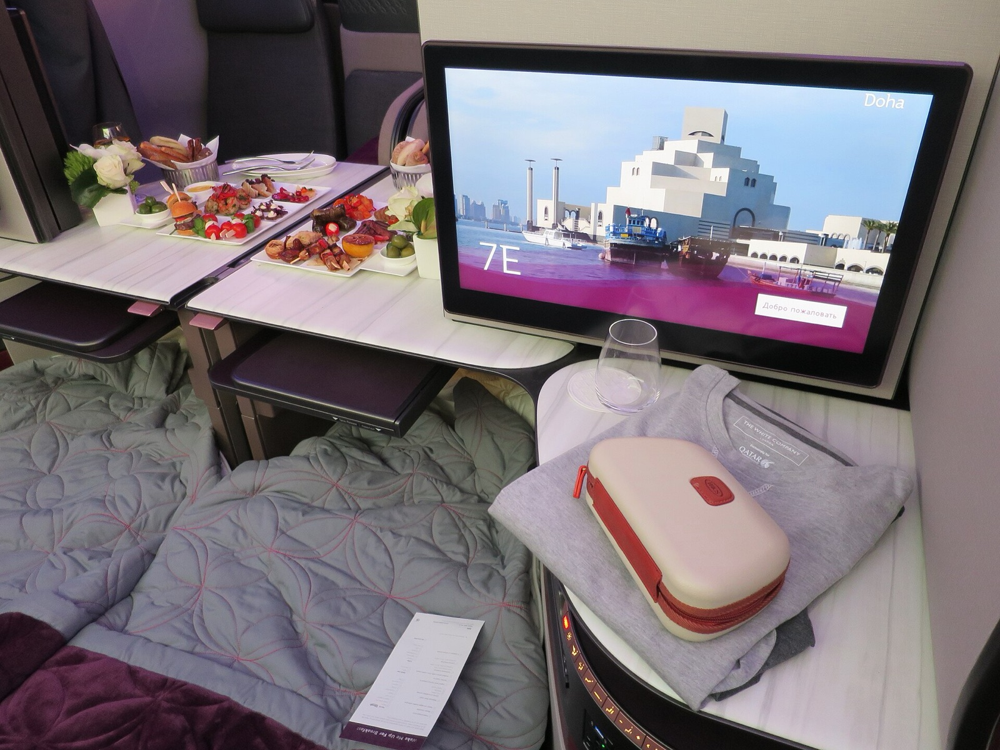

# 卡達 Qsuite 商務艙大放位！北美 13 城飛杜哈 2027 年 4～10 月，單程 70,000 Avios，用芬航 5 折 Avios 算只要約 760 美元

**新聞分類：哩程資訊／寰宇一家**
**發布日期：2026 年 11 月 4 日**

**卡達航空 Qsuite** 是公認最好的商務艙之一，現在北美 **13 個城市飛杜哈**在 **2027 年 4 月到 10 月**開出大量獎勵機位，單程只要 **70,000 Avios**。同樣的座位現金票常常超過 **7,000 美元**。這一波放位剛好碰上芬航買 Avios 5 折，算下來非常划算。

## 一、這次放位

| 項目 | 內容 |
| --- | --- |
| 艙等 | **Qsuite 商務艙** |
| 目的地 | 杜哈（DOH） |
| 日期 | **2027 年 4 月～10 月** |
| 價格 | **單程 70,000 Avios**＋稅費 |
| 現金票 | 單程常超過 7,000 美元 |
| 最佳訂法 | 卡達航空 Privilege Club（價格最低、位子最多） |
| 其他可訂 | JetBlue TrueBlue、美國航空 AAdvantage、阿拉斯加 Atmos（價格不同） |

### 13 個出發城市

| 地區 | 城市 |
| --- | --- |
| 美東 | 波士頓（BOS）、紐約（JFK）、費城（PHL）、華盛頓（IAD）、亞特蘭大（ATL）、邁阿密（MIA） |
| 美中 | 芝加哥（ORD）、達拉斯（DFW）、休士頓（IAH） |
| 美西 | 洛杉磯（LAX）、舊金山（SFO）、西雅圖（SEA） |
| 加拿大 | 蒙特婁（YUL） |

*卡達航空 Qsuite 商務艙（Travelarz／Wikimedia Commons，CC BY-SA 3.0 PL）*

## 二、Avios 從哪裡來

| 來源 | 方式 |
| --- | --- |
| 英國航空、芬蘭航空、伊比利航空、愛爾蘭航空 | Avios **免費、即時**轉到卡達 Privilege Club |
| 美國信用卡 | Amex、Bilt、Capital One、Citi 都能 **1：1** 轉入卡達 |
| Chase | 轉英航 Avios 加贈 30%（到 12/1），再轉卡達 |
| 芬航買 Avios | 11/16 前最高 5 折，每點約 1.09 美分 |

## 三、用芬航 5 折 Avios 算成本

| 項目 | 金額 |
| --- | --- |
| 70,000 Avios（每點約 1.085 美分） | 約 **760 美元** |
| 換算新台幣（1 美元 ≈ 32.63 元） | 約 **24,800 元** |
| 另付稅費 | 數百美元 |
| 對照現金票 | 單程常超過 7,000 美元 |

*匯率為 Mastercard 11/2 匯率；刷卡另有約 1.5% 海外交易手續費。*

芬航買 Avios 的細節可以看[芬航買 Avios 最高 5 折](/finnair-plus-buy-avios-50-off-tier-points-2026)，各家美國卡轉點加成可以看[美國信用卡 11 月轉點加成](/us-credit-card-transfer-bonuses-november-2026)。

## 四、要注意

- **先查位再轉點**：Avios 轉進卡達後不能轉回，確認有位再轉。
- **稅費**：從美國出發的卡達獎勵票，稅費約數百美元。
- **位子會被搶**：這種大放位通常很快就被訂走。
- **杜哈以遠**：繼續飛到其他目的地，Avios 會比 70,000 更多。

## 五、總結

**卡達 Qsuite 商務艙北美 13 城飛杜哈 2027 年 4～10 月大放位，單程 70,000 Avios；搭配芬航 11/16 前買 Avios 5 折，成本約 760 美元，遠低於 7,000 美元的現金票。** 有計畫明年去中東或經杜哈轉機的人，可以先查位。

### 消息來源

1. Upgraded Points：[[Award Alert] Fly Qatar Airways Qsuite From 70,000 Points One-Way](https://upgradedpoints.com/news/award-alert-qatar-airways-qsuites/)（2026/11/3）
2. 顏究所：[芬航 Finnair Plus 買 Avios 最高 5 折、每點約 1.09 美分](https://yenlabaero.com/finnair-plus-buy-avios-50-off-tier-points-2026)（2026/11/3，11/4 更新）
3. 顏究所：[美國信用卡 11 月轉點加成整理](https://yenlabaero.com/us-credit-card-transfer-bonuses-november-2026)（2026/11/2）

_封面照片：卡達航空 777-300ER 的 Qsuite 商務艙（Raymondeuro／[Wikimedia Commons](https://commons.wikimedia.org/wiki/File:Qsuite_on_Qatar_Airways_Boeing_777-300ER.jpg)，CC BY-SA 4.0），經裁切。_

_編輯註：本文整理截至 2026 年 11 月 4 日的資訊，以各公司官方公告為準。_
