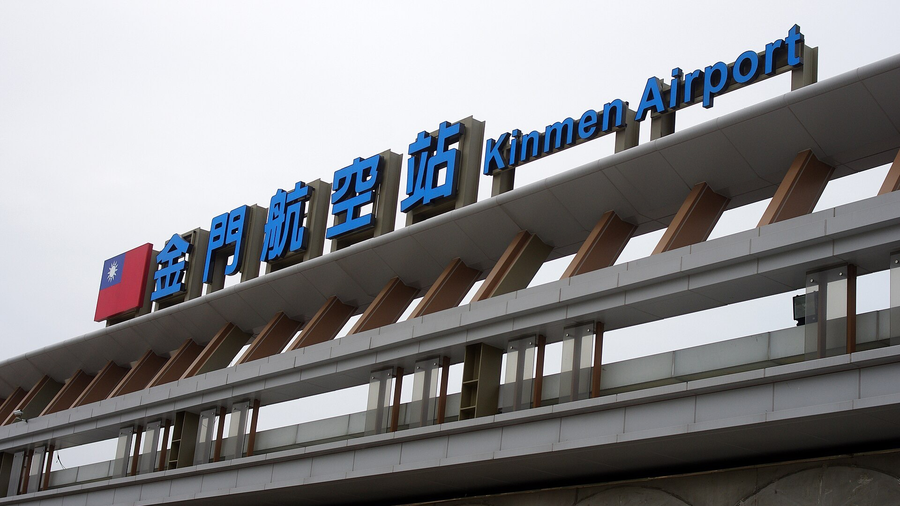

# 金門直飛吉隆坡雙向包機首航！峇迪航空執飛約 4 小時，不用再經台北轉機

**新聞分類：航空資訊／無聯盟**
**發布日期：2026 年 11 月 6 日**

**金門－馬來西亞吉隆坡直航雙向包機**在 **11/5 首航**，由**馬來西亞峇迪航空（Batik Air）**執飛，單趟約 **4 小時**。首航班機中午從吉隆坡載著 **171～172 名**旅客抵達金門尚義機場，接受水門禮；回程則載 **173 名**金門旅客飛往吉隆坡，兩邊各自展開 **6 天**行程。

_金門尚義機場（Livewireshock／Wikimedia Commons，CC BY-SA 4.0）_

## 一、首航資訊

| 項目 | 內容 |
| --- | --- |
| 首航日期 | **2026/11/5** |
| 航線 | 吉隆坡國際機場 ⇄ 金門尚義機場（雙向包機） |
| 執飛航空 | 馬來西亞**峇迪航空（Batik Air）** |
| 承辦旅行社 | 金門在地的**長伶國際旅行社** |
| 單趟航程 | 約 **4 小時**，和台北、桃園直飛吉隆坡差不多 |
| 吉隆坡 → 金門 | **171～172 人**（中央社 171 人、自由時報 172 人），多為金門僑親 |
| 金門 → 吉隆坡 | **173 人** |
| 行程 | 兩邊都是 **6 天** |
| 縣府補助 | 補助包機，也補助這趟旅客在金門的住宿 |

- **載重：** 金門縣府觀光處長許績鑫表示，考量載重、燃油等條件，這趟已算滿載。
- **旅行社經驗：** 長伶在 **2019/11/23** 承辦過金門第一次由非國籍航空執飛的國際包機。

## 二、為什麼是金門－馬來西亞？

金門早年有許多人「落番」到南洋發展，馬來西亞有大量金門僑親，這次馬來西亞的金門同鄉會也號召僑親參加，包括**馬六甲、巴生金門會館**的成員。

| 比較 | 以前 | 這次包機 |
| --- | --- | --- |
| 路線 | 吉隆坡 → 台北（住一晚）→ 金門 | 吉隆坡 → 金門直飛 |
| 時間 | 至少多一段國內線，常要過夜 | 約 4 小時直達 |
| 風險 | 金門霧季航班停飛，還要多付住宿 | 不用經台北轉機 |

搭包機回鄉的僑領**吳友鏗**，祖先吳心泉是金沙大地人，他曾和另一位繼承人把縣定古蹟「大地吳心泉宅」捐給金門縣政府。他說這是他第一次搭包機回金門，很多同行僑親「聽過金門，但從來沒有到過金門」，這趟就是要帶他們認識自己的祖籍地。

## 三、對旅客的影響

- **目前是包機，不是定期航班：** 要搭只能透過承辦旅行社的團體行程，不能像一般航班自己在航空公司官網訂票。
- **金門國際線的嘗試：** 縣府希望用包機模式讓僑親更方便回鄉，也讓金門旅客「走出去」，之後會不會常態化，要看這次的成效。
- **峇迪航空：** 馬來西亞峇迪航空的前身就是**馬印航空（Malindo Air）**，2022 年改名，屬於印尼獅航集團。

## 四、總結

**金門－吉隆坡雙向包機 11/5 首航，峇迪航空執飛約 4 小時，來回各載 170 多人、各自 6 天行程，縣府補助包機與住宿。** 對馬來西亞的金門僑親來說，不用再經台北轉機、也不怕金門霧季卡在台北，直飛方便很多；如果之後還有包機，再幫大家整理。

### 消息來源

1. 中央社：[馬來西亞包機直飛抵金門　僑親相約返祖籍地尋根](https://www.cna.com.tw/news/ahel/202611050167.aspx)（2026/11/5）
2. 自由時報：[金門-馬來西亞雙向包機首航！僑親回鄉尋根 僑領吳友鏗：方便很多](https://news.ltn.com.tw/news/Kinmen/breakingnews/5631024)（2026/11/5）

_封面照片：峇迪航空馬來西亞的 737 在吉隆坡機場（Bahnfrend／[Wikimedia Commons](https://commons.wikimedia.org/wiki/File:Batik_Air_Malaysia_Boeing_737_9M-LRG_Kuala_Lumpur_2026_(01).jpg)，CC BY-SA 4.0），經裁切。內文照片：金門尚義機場（Livewireshock／[Wikimedia Commons](https://commons.wikimedia.org/wiki/File:Kinmen_Airport_and_Surrounds_03.JPG)，CC BY-SA 4.0），經裁切。_

_編輯註：本文整理截至 2026 年 11 月 6 日的資訊，以各公司官方公告為準。_
