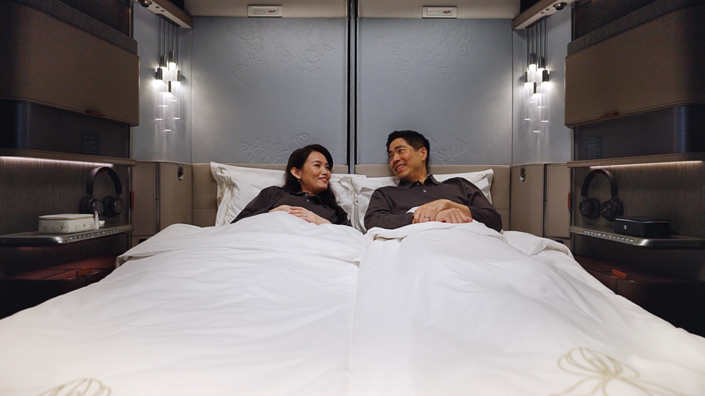
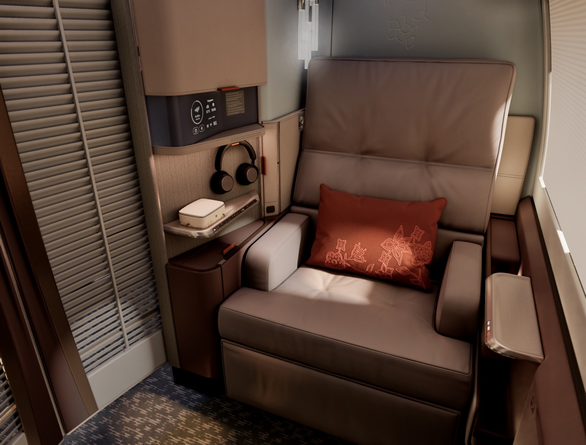
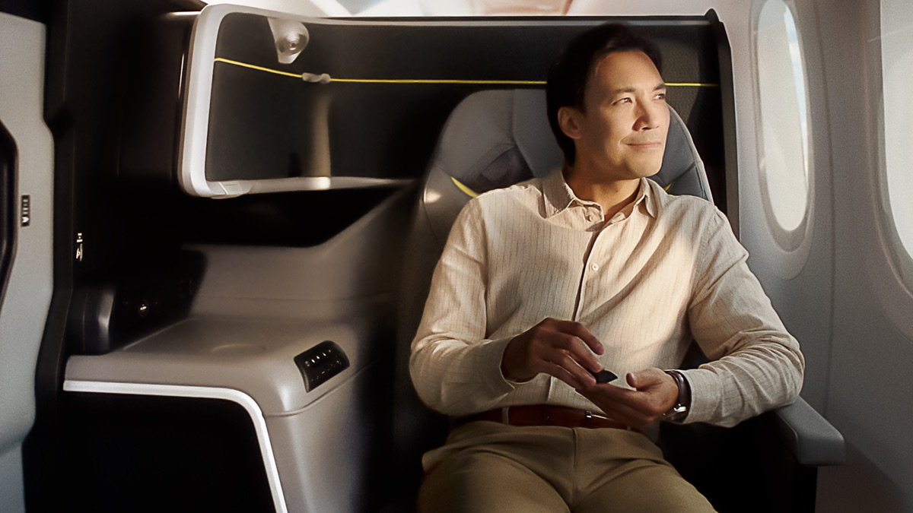
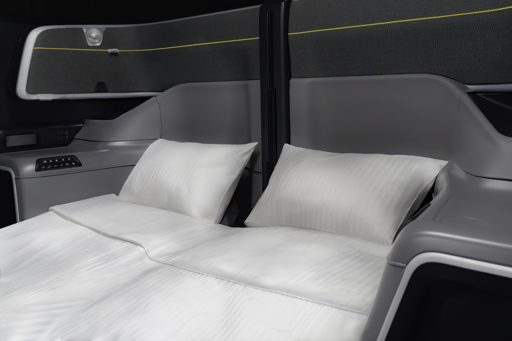
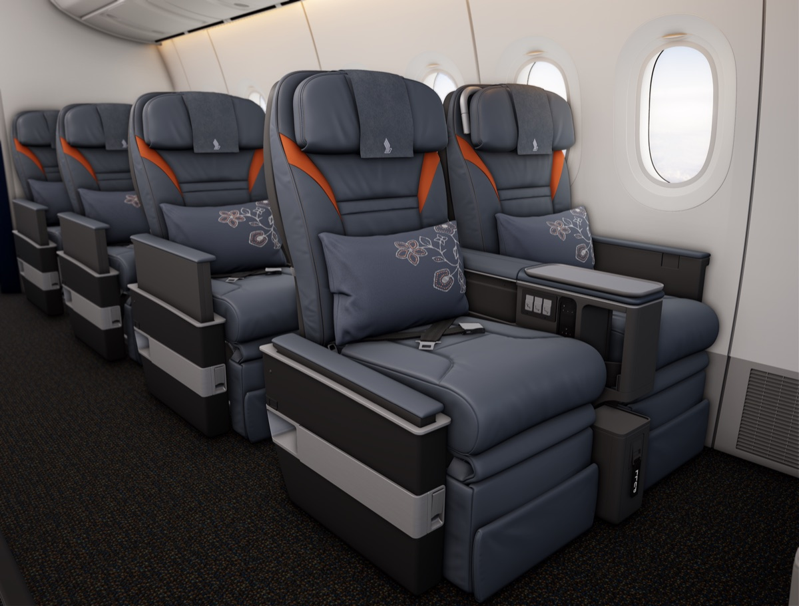
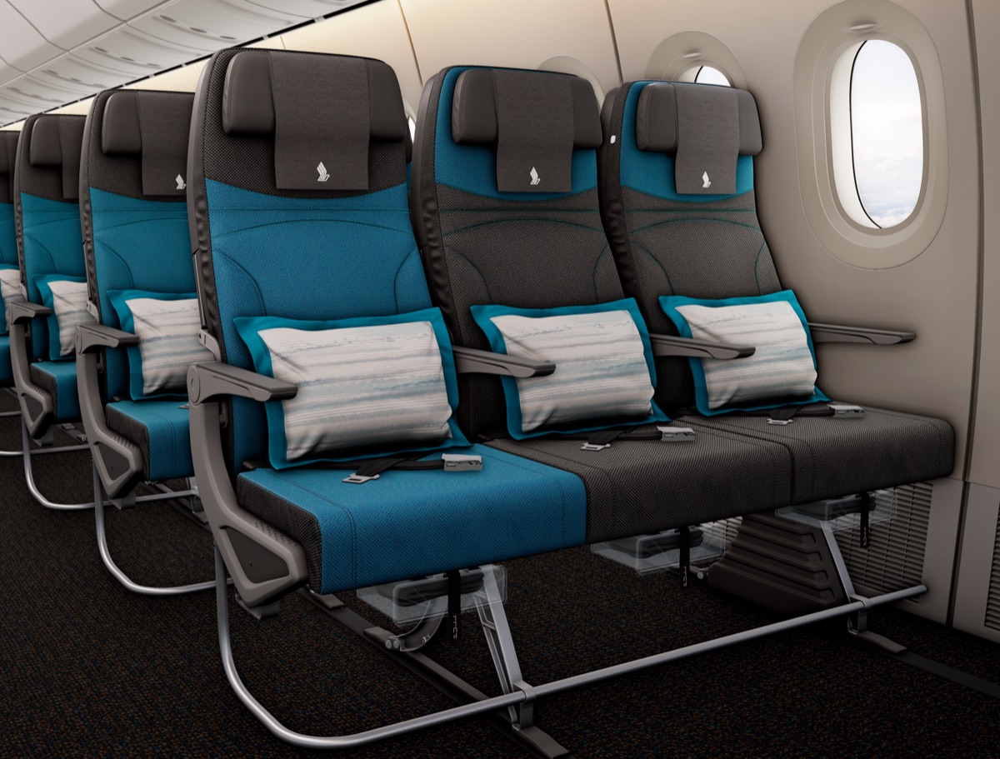

# 新航新頭等、商務艙正式亮相！頭等艙可併成最大雙人床，商務艙有門、坐著就能躺平，但又延到 2027 下半年

**新聞分類：航空資訊／星空聯盟**
**發布日期：2026 年 11 月 7 日**

**新加坡航空** 11/6 正式發表新一代**頭等、商務、豪華經濟、經濟艙**，投資約 **20 億新幣**，是新航史上最大的客艙投資。頭等艙中間兩席可以併成**民航最大的雙人床**，商務艙改成**有滑門、坐著就能躺平**的設計。不過新座椅因**認證問題再次延後**，最快 **2027 年下半年**才會上線。

> 10 月底我們先整理過發表會前的消息，可以參考[新航新客艙 11/7 發表](/singapore-airlines-new-cabins-november-2026)，這篇是正式發表後的完整規格。

## 一、哪些飛機會裝？

| 艙等 | A350-900LH（34 架改裝） | A350-900ULR（7 架改裝） | 777-9（31 架訂購中） |
| --- | --- | --- | --- |
| 頭等艙 | 無 | **4 席（新）** | **6 席（新）** |
| 商務艙 | **42 席（新）** | **70 席（新）** | **54 席（新）** |
| 豪華經濟艙 | 24 席（翻新） | 58 席（翻新） | **36 席（新）** |
| 經濟艙 | 192 席（翻新） | 無 | **204 席（新）** |

- **翻新：** A350 的豪經、經濟艙只換新的 KrisWorld 娛樂系統和布面，座椅不換。
- **預計順序：** 商務艙最先在改裝的 A350-900LH 上線，頭等艙要等第一架 A350-900ULR 改裝，豪經與全新經濟艙要等 777-9。

## 二、又延期了

| 時間點 | 第一架改裝 A350-900LH 上線 |
| --- | --- |
| 2024 年 11 月宣布時 | 2026 年第 2 季 |
| 之後第一次延後 | 2027 年第 1 季 |
| **這次** | **2027 年下半年** |

- **原因：** A350 上的新座椅還在等認證；777-9 的座椅已認證，但 777-9 飛機本身還沒取得認證。
- **改裝完成時間：** 新航仍說 41 架 A350 要在 **2030 年底**前改完；The Milelion 推估照原本速度可能拖到 2032 年。

## 三、新頭等艙

_新頭等艙中間兩席併成雙人床（圖片來源：新加坡航空）_

_新頭等艙靠窗單人套房（圖片來源：新加坡航空）_

| 項目 | 規格 |
| --- | --- |
| 製造／設計 | Collins Aerospace／PriestmanGoode |
| 配置 | **1-2-1**，有門（隔板高 170 公分） |
| 座椅寬度 | 23 吋（扶手放下 30 吋） |
| 床長 | **80 吋**，可完全躺平 |
| 雙人床 | 中間兩席的隔板可完全收起，併成 **80×60 吋**雙人床，民航最大 |
| 螢幕 | **32 吋 4K** 觸控（A350-900ULR 為 OLED） |
| 其他 | 藍牙耳機、無線充電、USB-C 快充；可把座椅與燈光偏好存在 KrisFlyer 帳號 |

- **靠窗單人座**有 3 個窗戶，有衣櫃、化妝台與一張扶手椅；不像 A380 套房有獨立的床，座椅本身放平就是床。
- 頭等艙沒有頭頂行李櫃，隨身行李放在腳凳下方。

## 四、新商務艙

_新商務艙靠窗座位，有滑門（圖片來源：新加坡航空）_

_新商務艙中間「蜜月座」放平併成雙人床（圖片來源：新加坡航空）_

| 項目 | A350-900LH／ULR | 777-9 |
| --- | --- | --- |
| 製造／設計 | Recaro／Designworks | 同左 |
| 配置 | **1-2-1**，有滑門（隔板高 132 公分） | 同左 |
| 座位間距 | 50 吋 | 50 吋 |
| 座椅寬度 | 22 吋 | 24 吋 |
| 床長 | 79 吋 | 79 吋 |
| 螢幕 | **22 吋 4K OLED** | 20 吋 4K |

- **坐著就能躺平：** 不用像現在的 2013 年版商務艙要站起來翻椅背，約 30 秒就能變成平躺床，起飛後不用等安全帶燈熄滅。
- **不再斜躺：** 所有座位都和走道平行，不用斜著睡。
- **蜜月座：** 中間座位交錯排列，「蜜月座」的電動隔板可以降下，併成兩張相鄰的床；A380 現在 78 個商務艙只有 6 個能併床，新客艙預估約 25～30%。
- **爭議：** 灰色系配黃色點綴，不少部落客覺得不像新航過去溫暖的風格；座椅寬度也比 2013 年版的 28 吋窄。

## 五、新豪經與經濟艙（只上 777-9）

_777-9 新豪華經濟艙（圖片來源：新加坡航空）_

_777-9 新經濟艙（圖片來源：新加坡航空）_

| 項目 | 豪華經濟艙 | 經濟艙 |
| --- | --- | --- |
| 座位數 | 36 席 | 204 席 |
| 配置 | 2-4-2 | 3-4-3 |
| 座位間距 | 40 吋 | 31～32 吋 |
| 座椅寬度 | 19 吋 | 17.6 吋 |
| 後仰 | 最多 9 吋 | 最多 6 吋 |
| 螢幕 | 最大 16 吋 4K | 最大 13 吋 4K |
| 其他 | 腿靠、真皮座椅 | 藍牙耳機、USB-C |

- **豪經被批評：** 沒有任何隱私設計，比起國泰、阿聯酋、長榮、日航新一代豪經，被認為一推出就過時。

## 六、對台灣旅客的影響

- **短期不受影響：** 新座椅最快 2027 下半年才上線，未來一年搭新航都還是現有座椅。
- **用哩程兌換的人：** 新商務艙的蜜月座在訂位時能不能選，還要看新航的選位規則。
- **新航其他升級：** 新菜單、新盥洗包和睡衣、新 KrisWorld 娛樂系統、Starlink 機上 Wi-Fi 會先陸續推出。

## 七、總結

**新航新頭等艙可以併成 80×60 吋雙人床，新商務艙有滑門、坐著就能躺平，但因認證延到 2027 年下半年才會在改裝的 A350 上線；全新豪經、經濟艙只裝在 777-9。** 頭等艙評價很高，商務艙功能進步但外觀見仁見智，豪經被認為最可惜。

### 消息來源

1. 新加坡航空：[Singapore Airlines Introduces Next-Generation Long-Haul Cabin Products](https://www.singaporeair.com/en_UK/sg/corporate/newsroom/press-release/2026/oct-to-dec-2026/Next_generation_Long_Haul_cabin_products/)（2026/11/6）
2. The Milelion：[Unveiled: Singapore Airlines' new First, Business, Premium Economy and Economy seats](https://milelion.com/2026/11/06/unveiled-singapore-airlines-new-first-business-premium-economy-and-economy-seats/)（2026/11/6）
3. The Milelion：[On the sidelines: 10 insights from SIA's next-generation cabin products launch](https://milelion.com/2026/11/07/on-the-sidelines-10-insights-from-sias-next-generation-cabin-products-launch/)（2026/11/7）
4. One Mile at a Time：[Singapore Airlines Unveils New First & Business Class Cabins For A350, 777-9](https://onemileatatime.com/news/singapore-airlines-new-first-business-class/)（2026/11/6）
5. 顏究所：[新航新客艙 11/7 發表！新頭等艙、商務艙、豪經全面換新，但全新豪經、經濟艙座椅只上 777-9](https://yenlabaero.com/singapore-airlines-new-cabins-november-2026)（2026/10/27）

_封面照片：新航新頭等艙雙人床（圖片來源：新加坡航空），經裁切。_

_編輯註：本文整理截至 2026 年 11 月 7 日的資訊，以各公司官方公告為準。_
