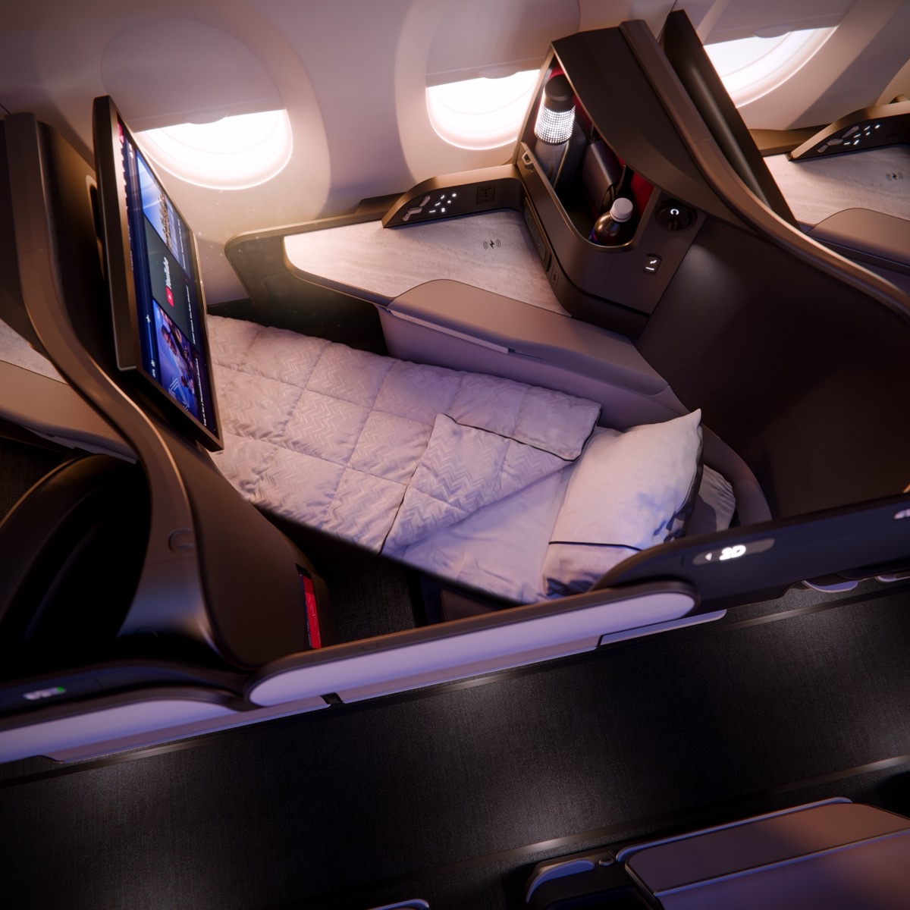
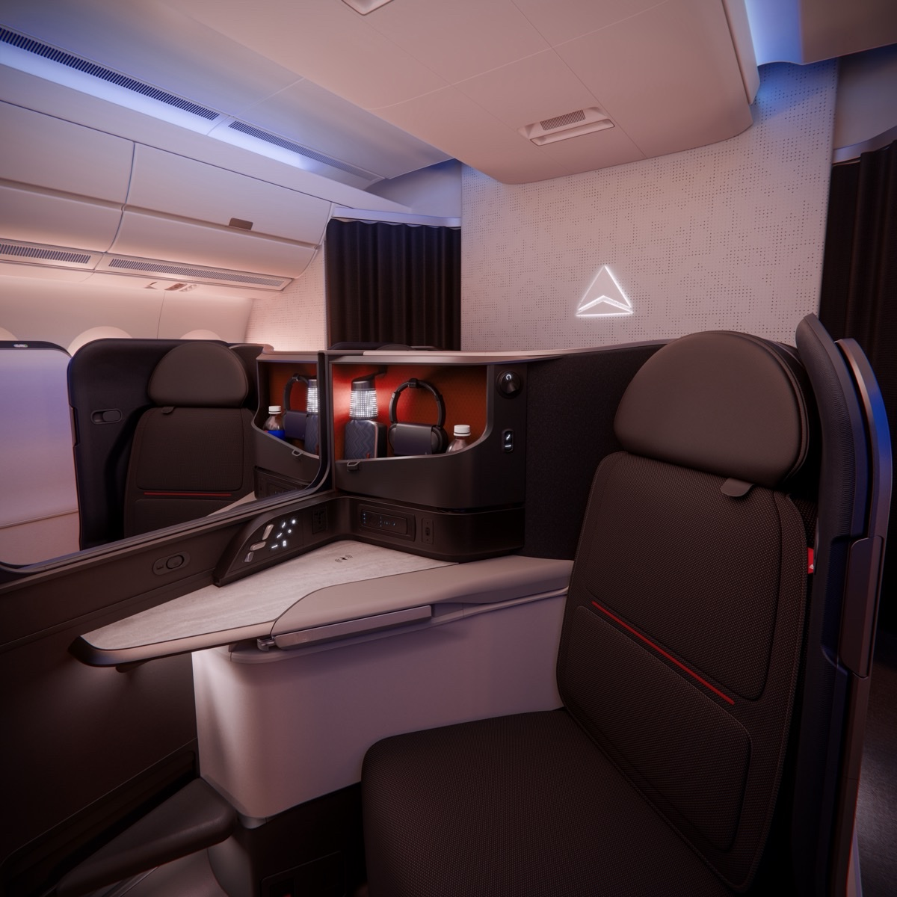

# 達美第一架 A350-1000 塗裝亮相！土魯斯廠曝光，2027 年 6 月首航，53 席新 Delta One 套房、半數座位是高端艙

**新聞分類：航空資訊／天合聯盟**
**發布日期：2026 年 11 月 10 日**

**達美航空第一架 Airbus A350-1000** 在 **11 月 9 日**於空中巴士**法國土魯斯廠**以完整塗裝曝光，是這款新旗艦首度公開亮相。達美預計 **2027 年 6 月**讓 A350-1000 投入商業飛行，機上配備新世代 **Delta One 套房**。

_A350-1000 新 Delta One 套房平躺模式（圖片來源：達美航空）_

## 一、第一架機基本資料

| 項目 | 內容 |
| --- | --- |
| 曝光日期 | **2026/11/9**，空中巴士土魯斯總裝廠 |
| 製造序號 | **MSN 841** |
| 目前狀態 | 已完成外部塗裝，仍要完成地面測試、試飛等程序才能交機 |
| 交機 | 達美官方資料寫 **2027 年初**開始交機 |
| 商業首航 | 預計 **2027 年 6 月** |
| 訂單 | **20 架**確認訂單，另有選擇權 |
| 下單時間 | **2024 年 1 月**，達美是第一家訂 A350-1000 的美國航空公司 |
| 地位 | 將成為**達美機隊最大**的飛機 |

## 二、客艙配置

| 艙等 | 座位數 |
| --- | --- |
| **Delta One（商務艙套房）** | **53 席** |
| **Delta Premium Select（豪經）** | **48 席** |
| Delta Comfort＋、Main Cabin（經濟艙） | **213 席** |
| **合計** | **約 314 席** |

達美表示 A350-1000 的**高端座位比例約 50%**，是目前高端艙比例最高的機型之一。

## 三、新世代 Delta One 套房

_新 Delta One 套房的置物空間與設備（圖片來源：達美航空）_

| 項目 | 內容 |
| --- | --- |
| 配置 | **反魚骨**，每席直通走道；靠窗座位朝外 |
| 中間座位 | **可移動隱私隔板**，同行旅客可打開 |
| 平躺床長 | 超過 **6.5 英尺（約 198 公分）** |
| 座椅 | 枕頂式坐墊（pillow-top） |
| 螢幕 | **24 吋**高畫質螢幕 |
| 連線 | **藍牙**音訊、無線充電、USB-C 與萬用插座 |
| 收納 | 更多置物空間 |
| 其他 | 商務艙旅客專用**自助點心飲料區** |
| 研發 | 2 年設計、累積 10 年旅客與員工意見 |

全機所有座位都有達美**最大尺寸的椅背螢幕**、記憶泡棉坐墊，以及**免費高速 Wi-Fi**。

## 四、性能與可能航線

| 項目 | 內容 |
| --- | --- |
| 引擎 | 勞斯萊斯 **Trent XWB-97** |
| 航程 | 約 **8,700 海浬（約 16,112 公里）** |
| 油耗 | 每座位英里油耗比被取代的機型低 **20% 以上** |
| 可能航線 | 外媒報導可能先飛**亞特蘭大、底特律－首爾**；達美尚未正式公布 |

## 五、對台灣旅客的意義

達美目前沒有飛台灣，但台灣旅客常經**首爾仁川**轉搭達美或大韓航空到美國。如果 A350-1000 真的先飛首爾航線，就可能透過仁川轉機體驗到新 Delta One；實際航線仍以達美公告為準。

## 六、總結

**達美第一架 A350-1000 在土魯斯塗裝亮相，2027 年 6 月首航，53 席新 Delta One 反魚骨套房、48 席豪經，高端座位約一半。** 這是達美近年最重要的新客艙，正式航線公布後我們再更新。

### 消息來源

1. Simple Flying：[Delta's 1st A350-1000 Spotted In Full Livery Ahead Of June 2027 Debut](https://simpleflying.com/delta-1st-a350-1000-spotted-debut-june-2027/)
2. 達美航空：[Delta News Hub](https://news.delta.com/)（A350-1000 官方照片）
3. 顏究所：[達美 Delta One 近 30 年最大翻新！和牛漢堡、Missoni 新過夜包、羽田航線獺祭清酒，洛杉磯長程線先上](https://yenlabaero.com/delta-one-new-service-2026)

_封面照片：達美 A350-1000 新 Delta One 套房平躺模式（達美航空）。_

_編輯註：本文整理截至 2026 年 11 月 10 日的資訊，以各公司官方公告為準。_
