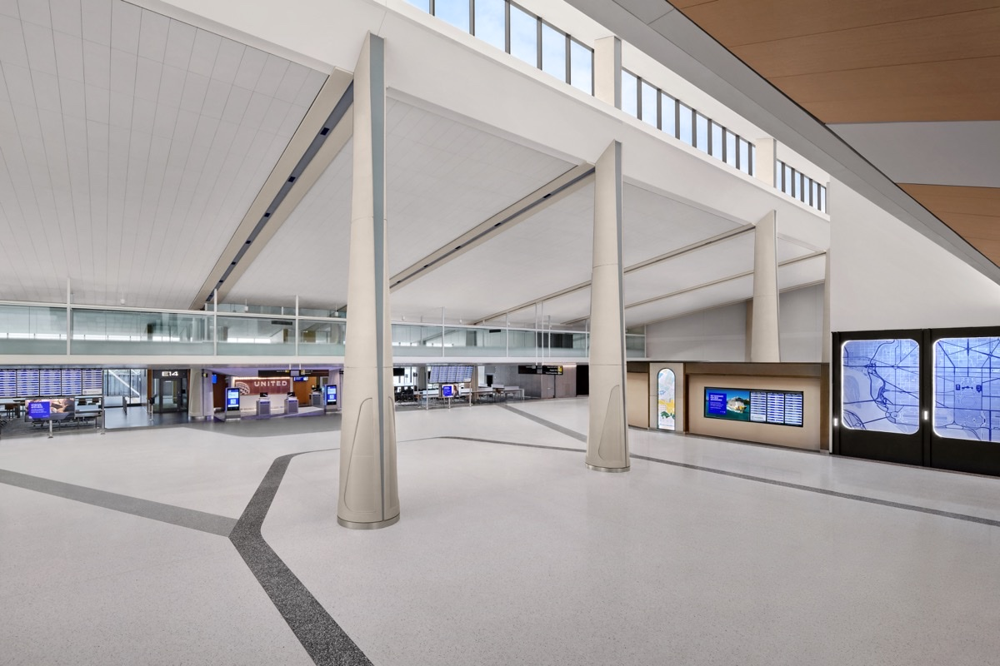
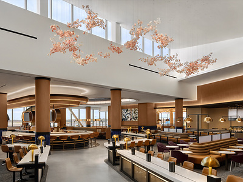
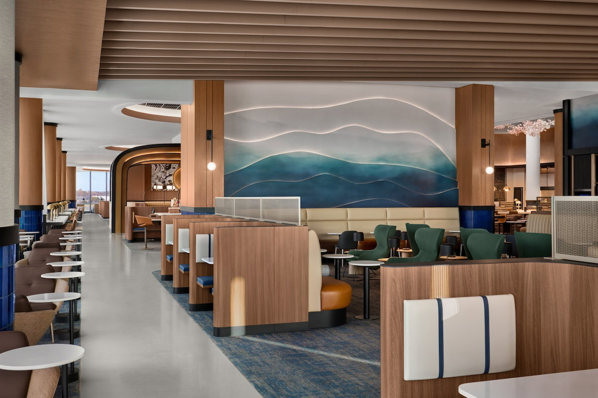

# 華盛頓杜勒斯機場 E 大廳啟用！20 年來第一座新大廳，聯合航空 14 個新登機門、近 4 萬平方英尺 United Club 可坐 600 人

**新聞分類：航空資訊／星空聯盟**
**發布日期：2026 年 11 月 10 日**

**華盛頓杜勒斯機場（IAD）E 大廳**在 **2026 年 11 月 10 日**正式啟用，是機場**近 20 年來第一座新大廳**。E 大廳由**聯合航空**專用，一口氣增加 **14 個登機門**，並設有近 **4 萬平方英尺**、超過 **600 個座位**的新 **United Club**，是聯航**第二大貴賓室**。

_杜勒斯機場新 E 大廳（圖片來源：聯合航空）_

## 一、E 大廳基本資料

| 項目 | 內容 |
| --- | --- |
| 啟用日期 | **2026/11/10**（11/9 媒體預覽、剪綵） |
| 面積 | **43.5 萬平方英尺**（約 4 萬平方公尺） |
| 登機門 | **14 個**，聯合航空專用 |
| 機型彈性 | 每個登機門可停 **1 架廣體機或 2 架窄體機**，國內、國際線都能用 |
| 交通 | **AeroTrain 直達**主航廈 |
| 設施 | 自然採光候機區、座位插座與無線充電、新廁所、美食街 |
| 營運效益 | 明年夏天聯航可在杜勒斯飛**每天超過 300 班**，尖峰時段連結性增加近 **30%** |
| 計畫 | 杜勒斯 **200 億美元以上**的「Dulles Global Gateway」現代化計畫第一步 |

## 二、新 United Club：聯航第二大貴賓室

_E 大廳新 United Club，天花板裝置以櫻花為靈感（圖片來源：聯合航空）_

| 項目 | 內容 |
| --- | --- |
| 面積 | 近 **4 萬平方英尺**（約 3,700 平方公尺） |
| 座位 | 超過 **600 個** |
| 規模 | 聯航**第二大** United Club，僅次於休士頓 IAH |
| 空間增加 | 聯航在杜勒斯的貴賓室空間增加約 **70%** |
| 位置 | **E14、E16 登機門對面** |
| 開放時間 | 每天 **5:30～22:00** |
| 設施 | 吧台、**2 個自助餐區**（含拉麵站）、**8 間私人電話間**、免費高速 Wi-Fi、幾乎每個座位都有插座 |
| 沒有 | **淋浴間**、咖啡師手沖咖啡 |
| 設計 | 以杜勒斯主航廈建築、華府櫻花、藍嶺山脈為靈感，展示華府在地藝術家作品 |
| 進入資格 | 依一般 United Club 規定 |

_United Club 座位區，牆面以藍嶺山脈為靈感（圖片來源：聯合航空／One Mile at a Time）_

## 三、E 大廳餐飲與商店

| 類型 | 店家 |
| --- | --- |
| 餐廳 | Aventino（羅馬料理）、Ellie Bird、Bonchon、Dos Toros Taqueria、Rusty Taco |
| 咖啡、甜點 | Starbucks、Good Company Doughnuts & Café |
| 酒類 | Honor Brewing、MurLarkey Distilled Spirits |
| 其他 | Travel Tech、**Gameway** 電玩休息室（可用 Priority Pass） |

## 四、接下來的工程

| 階段 | 內容 |
| --- | --- |
| E 大廳第 1 期 | **2026/11/10 啟用**，14 個登機門 |
| E 大廳第 2～4 期 | 最多再增加 **36 個**聯航登機門、轉機旅客國際入境檢查區 |
| Polaris 貴賓室 | 規劃為聯航**全球最大之一**的 Polaris 商務艙貴賓室，尚未公布時間 |
| C、D 大廳 | 1985 年蓋的「臨時」大廳，未來將關閉 |
| 移動式候機車 | 杜勒斯招牌的 Mobile Lounge 將由 AeroTrain 取代，預計 **2034 年**退場 |

## 五、聯航在杜勒斯的布局

| 項目 | 數字 |
| --- | --- |
| 每日航班 | 超過 **250 班**，飛 **135 個**航點 |
| 2022 年以來新增航點 | 超過 **20 個** |
| 2022 年以來航班成長 | **30%** |
| 華府地區員工 | 近 **8,000 人** |
| 2027 年新長程航點 | 法國**土魯斯**、義大利**米蘭** |
| A321XLR | 12 月起從杜勒斯飛**阿姆斯特丹、都柏林**，是聯航 A321XLR 首批國際線 |

## 六、總結

**杜勒斯機場 E 大廳 11/10 啟用，14 個聯航專用登機門、AeroTrain 直達，新 United Club 近 4 萬平方英尺、600 多個座位，是聯航第二大貴賓室。** 杜勒斯一直被詬病設施老舊，E 大廳是真正的改善起點；之後還有 3 期工程與大型 Polaris 貴賓室，經華府轉機的旅客會越來越有感。

### 消息來源

1. 聯合航空：[United Airlines and the Metropolitan Washington Airports Authority Unveil First New Concourse in Two Decades at Washington Dulles International Airport](https://united.mediaroom.com/2026-11-09-United-Airlines-and-the-Metropolitan-Washington-Airports-Authority-Unveil-First-New-Concourse-in-Two-Decades-at-Washington-Dulles-International-Airport)
2. One Mile at a Time：[Washington Dulles Concourse E Opens, With Huge New United Club](https://onemileatatime.com/news/washington-dulles-concourse-e-united-club/)
3. Upgraded Points：[First Look Inside Washington Dulles' New Concourse E](https://upgradedpoints.com/news/dulles-new-concourse-e/)
4. The Points Guy：[First look: United unveils gorgeous new Washington Dulles concourse, massive lounge](https://thepointsguy.com/news/washington-dulles-international-airport-united-airlines-concourse-e-club/)

_封面照片：杜勒斯機場 E 大廳（聯合航空）。_

_編輯註：本文整理截至 2026 年 11 月 10 日的資訊，以各公司官方公告為準。_
