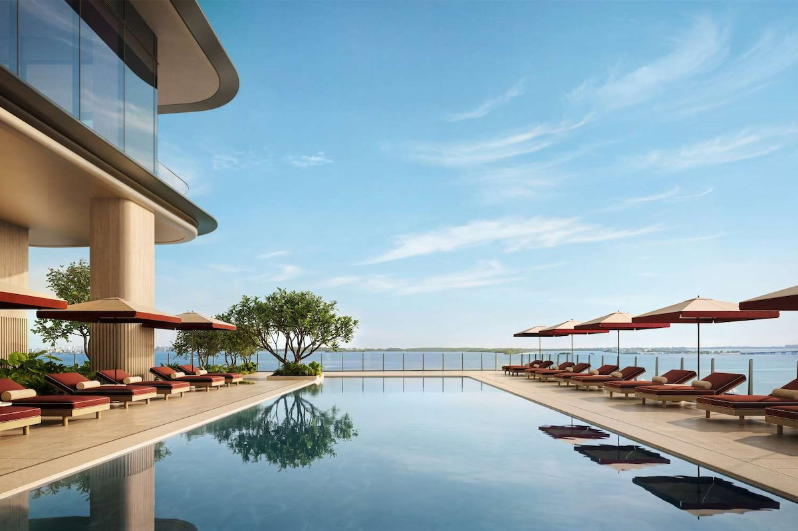
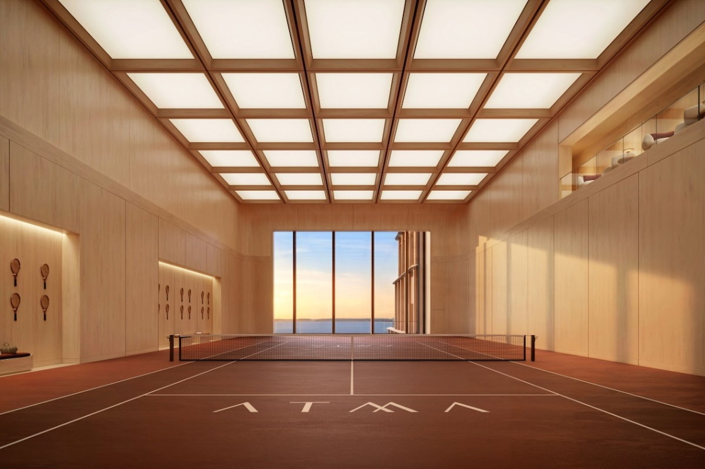

# 安縵推第三個品牌「ATMA」！喬科維奇打造運動健康設施，首間邁阿密 320 公尺高樓、480 戶住宅，2031 年開幕

**新聞分類：飯店資訊／集團體系**
**發布日期：2026 年 11 月 12 日**

**安縵集團（Aman Group）**推出第三個品牌「**ATMA**」，定位為「**performance living**」超奢華品牌，結合健康、運動、營養餐飲、設計與體驗式娛樂。首間 **ATMA Miami** 預計 **2031 年**在邁阿密開幕，是一棟 **1,049 英尺（約 320 公尺）**的獨棟高樓。

_ATMA Miami 泳池示意圖（圖片來源：Aman Group）_

## 一、ATMA 是什麼？

| 項目 | 內容 |
| --- | --- |
| 品牌名 | **ATMA**，梵文「靈魂」「真我」 |
| 定位 | 「performance living」**超奢華**品牌 |
| 核心 | 進階健康療程、世界級運動設施、營養導向餐飲、設計、體驗式娛樂 |
| 合作夥伴 | **喬科維奇（Novak Djokovic）**擔任 ATMA 全球夥伴，開發運動健康設施 |
| 據點類型 | 都市與偏遠目的地都會有 |
| 集團品牌 | **Aman**（原始品牌）、**Janu**（較活潑的生活風格品牌）、**ATMA**（新） |

## 二、首間 ATMA Miami

| 項目 | 內容 |
| --- | --- |
| 地點 | 邁阿密 **Brickell** 區 |
| 開幕 | 預計 **2031 年** |
| 建築 | **1,049 英尺（約 320 公尺）**獨棟大樓，邁阿密建築高度上限 |
| 組成 | **飯店**、**品牌住宅**、**私人會員俱樂部** |
| 住宅 | **480 戶**，1～6 房，由安縵集團提供服務 |
| 碼頭 | **私人碼頭** |
| spa | **12 萬平方英尺（約 11,000 平方公尺）**，邁阿密最大 |
| 飯店房數 | 尚未公布 |

_ATMA Miami 室內球場示意圖（圖片來源：Aman Group）_

## 三、運動健康設施

| 類型 | 內容 |
| --- | --- |
| 球場 | 室內**匹克球（padel）**、**網球**、**壁球** |
| 訓練 | 健身中心、團體與私人訓練室 |
| 進階 | 活動度與體能訓練實驗室 |
| 醫療 | **醫療健康中心** |
| 恢復 | 專屬恢復空間、表現與恢復療程 |

## 四、安縵近年的轉變

| 階段 | 內容 |
| --- | --- |
| 早期 | 創辦人 Adrian Zecha，以偏遠、小規模度假村聞名 |
| 2014 年後 | 品牌易主，開始發展**城市飯店** |
| 近年 | 推出**私人會所**、**Janu** 品牌、大型**品牌住宅** |
| 2026 年 | 推出 **ATMA**，進軍 300 公尺級摩天大樓 |

## 五、總結

**安縵推出第三個品牌 ATMA，主打運動與健康的超奢華生活，喬科維奇開發運動設施；首間 ATMA Miami 2031 年開幕，320 公尺高樓含飯店、480 戶住宅、私人會所與 11,000 平方公尺 spa。** 和安縵早期隱世小度假村的形象差很多，也代表奢華飯店集團越來越倚重品牌住宅。

### 消息來源

1. One Mile at a Time：[ATMA: Aman's New Brand, Debuting With A 1,049-Foot Miami Tower](https://onemileatatime.com/news/atma-aman-brand/)

_封面圖：ATMA Miami 外觀示意圖（Aman Group）。_

_編輯註：本文整理截至 2026 年 11 月 11 日的資訊，以各公司官方公告為準。_
