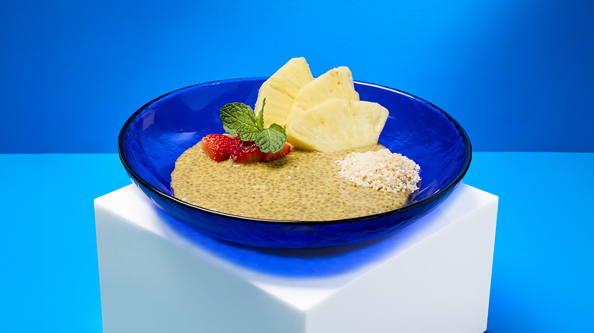
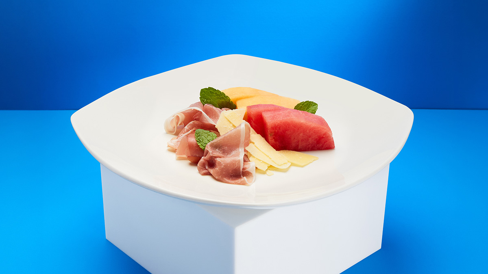
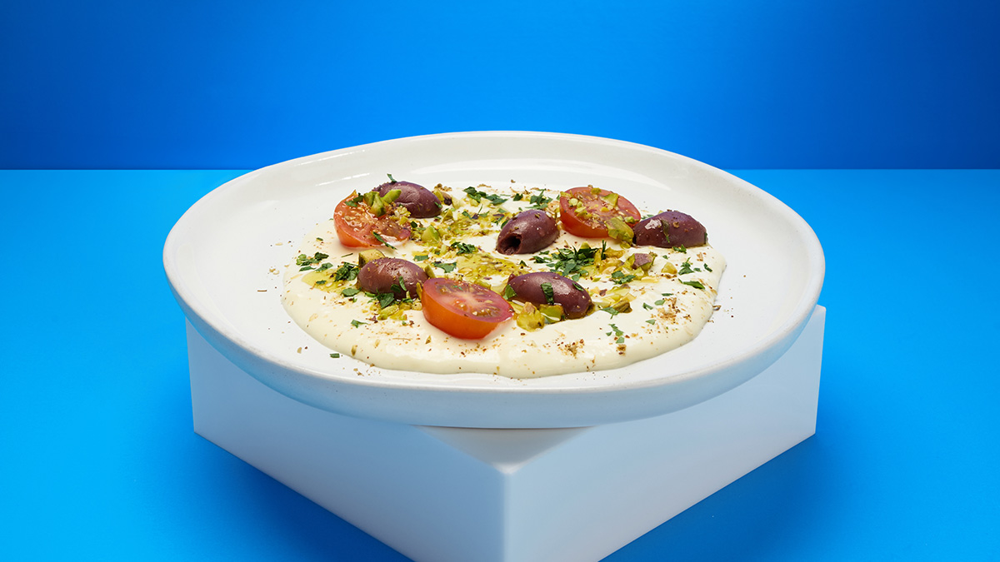
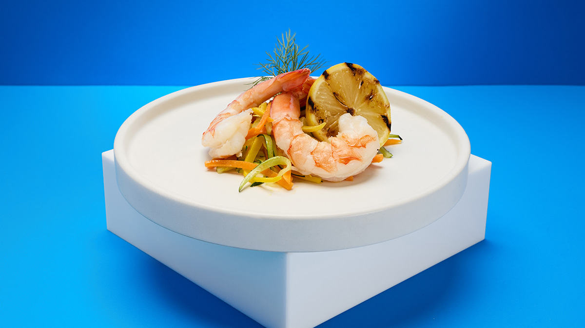

# 美國航空頭等艙短程線恢復鮮食！700～899 英里航班推「Light Bites」，芝加哥－紐約先上，煙燻鮭魚、布拉塔起司二選一

**新聞分類：航空資訊／寰宇一家**
**發布日期：2026 年 11 月 12 日**

**美國航空**從 **11 月**起，在**芝加哥歐海爾往返紐約甘迺迪、拉瓜迪亞**的**頭等艙**推出「**Light Bites**」輕食，把鮮食延伸到 **700～899 英里**的短程航班。美系航空原本只有 900 英里以上的航班才在頭等艙供餐，美航這次走在前面。

_熱帶奇亞籽隔夜燕麥（圖片來源：美國航空）_

## 一、重點整理

| 項目 | 內容 |
| --- | --- |
| 開始 | **2026 年 11 月** |
| 首批航線 | **芝加哥（ORD）⇄ 紐約甘迺迪（JFK）、拉瓜迪亞（LGA）** |
| 適用距離 | **700～899 英里**（約 1,130～1,450 公里） |
| 艙等 | **頭等艙** |
| 選擇 | 每班 **2 種**二選一，菜單全年輪替 |
| 預訂 | **只在機上提供**，不能事先預訂 |
| 其他航線 | 尚未公布擴大時程 |

## 二、菜單

| 早餐 | 午餐／晚餐 |
| --- | --- |
| 煙燻鮭魚 | 咖哩雞沙拉 |
| 熱帶奇亞籽隔夜燕麥 | 泰式麵沙拉 |
| 生火腿哈密瓜 | 火雞肉高達起司三明治 |
| 水果起司盤 | 打發布拉塔起司 |
| 生火腿布里起司 | 水煮鮮蝦麵沙拉 |
| 蘋果肉桂奇亞籽布丁 | 中東拼盤（mezze） |
| － | 卡津香料烤雞 |
| － | 烤蔬菜捲 |

_生火腿哈密瓜（圖片來源：美國航空）_

_打發布拉塔起司（圖片來源：美國航空）_

## 三、美系航空頭等艙供餐比較

| 航空 | 900 英里以上 | 700～899 英里 | 700 英里以下 |
| --- | --- | --- | --- |
| **美國航空** | 正餐（用餐時段） | **Light Bites 鮮食（芝加哥－紐約起）** | 飲料、零食 |
| 達美 | 正餐（用餐時段） | 包裝零食 | 包裝零食 |
| 聯合 | 正餐（用餐時段） | 包裝零食 | 包裝零食 |
| 阿拉斯加 | 正餐 | 多數航班有鮮食點心 | 多數航班有鮮食點心 |

_水煮鮮蝦麵沙拉（圖片來源：美國航空）_

## 四、美航近期的餐飲升級

| 項目 | 內容 |
| --- | --- |
| 經濟艙 | 更新免費零食 |
| 達拉斯出發頭等艙 | Pecan Lodge 烤肉擴大到所有符合資格航班 |
| 洛杉磯 | Flagship Dining 重新開幕 |
| 貴賓室 | Flagship、Admirals Club 餐飲升級 |

## 五、總結

**美國航空 11 月起在芝加哥－紐約頭等艙推出 Light Bites，700～899 英里航班改供兩種鮮食二選一，不能預訂。** 這在美系航空的短程頭等艙算少見，之後會不會擴大到其他航線，再看美航公告。

### 消息來源

1. 美國航空：[First Class favorites take flight: American Airlines brings light bites to the menu between Chicago and New York](https://news.aa.com/news/news-details/2026/American-brings-light-bites-to-the-menu-between-Chicago-and-New-York-MKG-OB-11/default.aspx)
2. One Mile at a Time：[American First Class Will Get Mini-Meals On Shorter Flights (700-899 Miles)](https://onemileatatime.com/news/american-first-class-mini-meals-shorter-flights/)
3. 顏究所：[美國航空洛杉磯 Flagship 餐廳關閉 6 年後重開！商務艙可進，也能用 2 萬哩買通行證](https://yenlabaero.com/american-airlines-lax-flagship-dining-reopens-2026)

_封面照片：美國航空 Light Bites 輕食（美國航空），經裁切。_

_編輯註：本文整理截至 2026 年 11 月 12 日的資訊，以各公司官方公告為準。_
