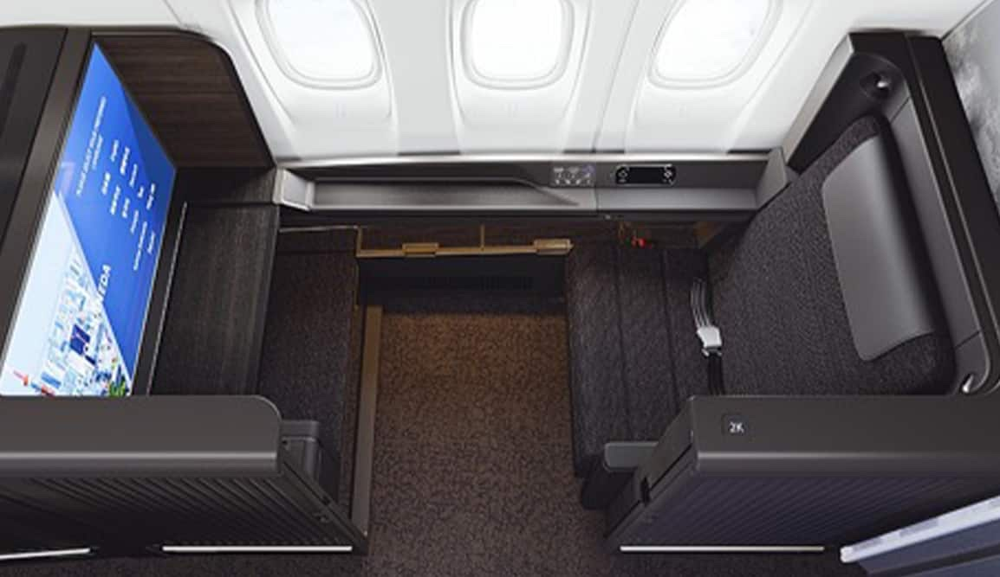
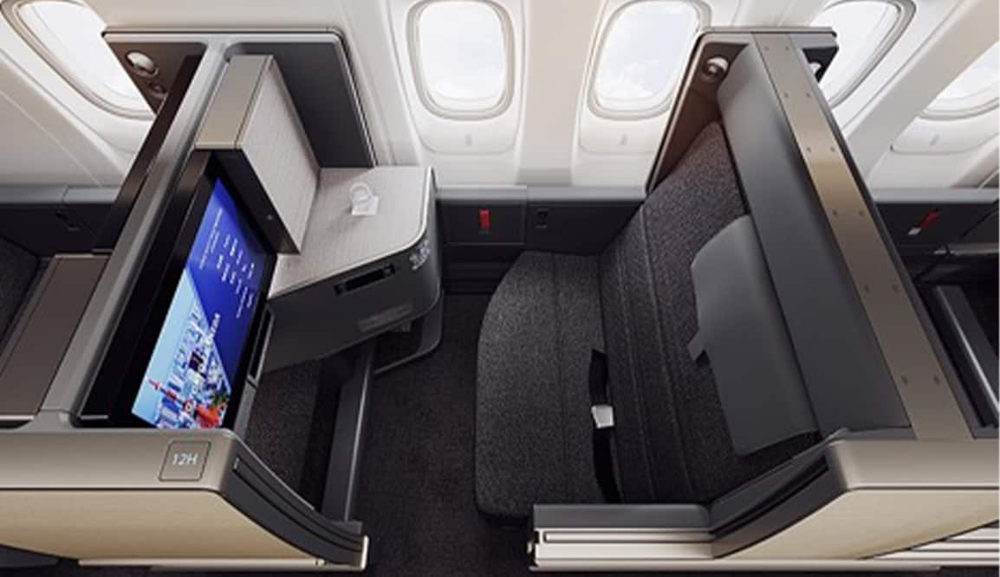
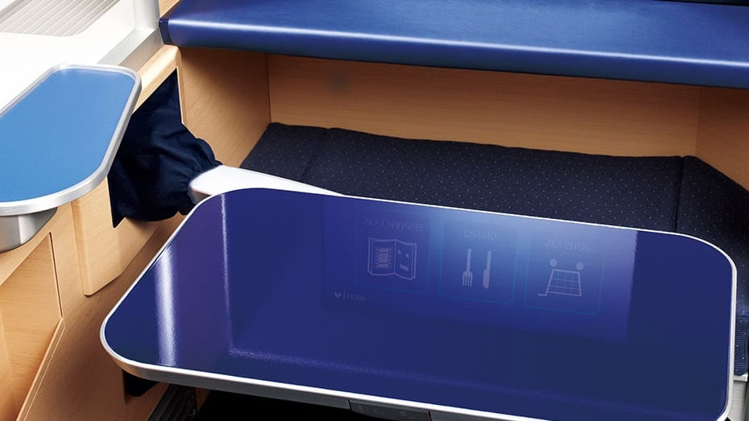

# 想搭 ANA 頭等艙 THE Suite、商務艙 THE Room？13 架 777 只有 10 架有新客艙，倫敦、紐約全班都是，芝加哥、舊金山要看座位圖

**新聞分類：航空資訊／星空聯盟**
**發布日期：2026 年 11 月 12 日**

**全日空 ANA** 在 2019 年推出 777-300ER 新頭等艙 **THE Suite** 與新商務艙 **THE Room**，至今仍是全球評價最高的頭等、商務艙之一。不過 ANA **13 架 777-300ER 只有 10 架**裝了新客艙，而且只飛特定航線；想搭的人要先知道哪些航班、怎麼確認。

_777-300ER 頭等艙 THE Suite（圖片來源：ANA）_

## 一、THE Suite 與 THE Room 規格

| 項目 | 頭等艙 THE Suite | 商務艙 THE Room |
| --- | --- | --- |
| 座位數 | **8 席** | **64 席** |
| 隱私 | **滑門**＋個室型外殼 | **滑門**，個室型座位 |
| 螢幕 | **43 吋** 4K | **24 吋** 4K |
| 平躺 | 全平躺 | 全平躺 |
| 配置特色 | 中間座位有可移動隔板 | 前後向交錯排列，**每席直通走道**；雙人座有可移動隔板 |
| 座椅 | 和西川（Nishikawa）合作的內建坐墊 | 和西川合作的寬座椅 |
| 收納 | **個人衣櫃**（可掛外套）、大型收納 | 大型桌板、大型邊桌 |
| 電源 | 萬用電源、HDMI、USB | 萬用電源、USB |
| 全機座位 | 212 席（新配置） | 同左 |

_777-300ER 商務艙 THE Room，座位有門（圖片來源：ANA）_

## 二、哪些飛機有新客艙？

| 項目 | 數量 |
| --- | --- |
| ANA 777-300ER 總數 | **13 架** |
| 有新客艙 | **10 架**（約 77%） |
| 2019 年後交機就有新客艙 | 6 架 |
| 舊機改裝 | 4 架 |
| 仍是舊客艙 | **3 架** |

| 新客艙機身（10 架） | 舊客艙機身（3 架） |
| --- | --- |
| JA784A、JA785A、JA787A、JA788A、JA793A、JA794A、JA795A、JA796A、JA797A、JA798A | JA790A、JA791A、JA792A |

ANA 目前沒有改裝剩下 3 架的計畫，新客艙的數量短期內不會再增加；之後的 777-9 預計會有同等或更新的產品，但 777X 已延誤多年。

## 三、哪些航線有新客艙？

| 航線 | 航班 | 新客艙排班 |
| --- | --- | --- |
| **東京羽田 ⇄ 倫敦希斯洛** | NH211/212 | **全部班次** |
| **東京羽田 ⇄ 紐約甘迺迪** | NH109/110、NH159/160 | **全部班次** |
| 東京羽田 ⇄ 芝加哥 | NH111/112 | 部分班次，依星期不同 |
| 東京成田 ⇄ 芝加哥 | NH11/12 | 部分班次，依星期不同 |
| 東京羽田 ⇄ 舊金山 | NH107/108 | 部分班次，依星期不同 |
| 東京成田 ⇄ 舊金山 | NH7/8 | 部分班次，依星期不同 |

- 休士頓、洛杉磯、西雅圖、華盛頓等美國航點目前用 **787**，沒有這套客艙。
- 航空公司可能臨時換機，出發前再確認一次。

## 四、怎麼確認自己搭到新客艙？

| 方法 | 新客艙 | 舊客艙 |
| --- | --- | --- |
| **商務艙座位數** | **64 席** | 52 或 68 席 |
| **商務艙排數** | 排到**第 20 排** | 不到第 20 排 |
| ANA 官網 | 顯示「**THE SUITE**」「**THE ROOM**」 | 沒有 |
| Google Flights | 商務艙標示「**Individual suite**」 | 標示「Lie flat seat」 |

_頭等艙大型桌板（圖片來源：ANA）_

## 五、其他機型呢？

| 機型 | 頭等艙 | 商務艙 |
| --- | --- | --- |
| **777-300ER（10 架）** | THE Suite | THE Room |
| A380 | 和 777 新頭等艙**很接近** | 舊款商務艙，差異最大 |
| 787-9（未來） | － | 規劃裝類似產品「**THE Room FX**」，首架延誤中 |
| 其他 787、767 | － | 舊款商務艙 |

## 六、從台灣怎麼搭？

- ANA 台北航線不是用 777-300ER，想搭 THE Suite／THE Room，要從台北飛東京，再轉**羽田飛倫敦、紐約**，或碰運氣搭芝加哥、舊金山航班。
- 用哩程兌換時，ANA 是星空聯盟成員，可以用各家星空聯盟哩程計畫查詢獎勵機位；頭等艙獎勵機位對夥伴通常很少，商務艙較有機會。
- 羽田－倫敦、紐約全部班次都是新客艙，是最穩的選擇。

## 七、總結

**ANA 777-300ER 新頭等艙 THE Suite（8 席）與商務艙 THE Room（64 席）目前在 13 架中的 10 架，羽田飛倫敦、紐約全班都是，芝加哥、舊金山新舊輪流。** 訂位前看商務艙是不是 64 席、排到第 20 排，或官網有沒有顯示 THE ROOM，就能確認。

### 消息來源

1. One Mile at a Time：[Which Routes Feature ANA's New Boeing 777 First & Business Class Cabins?](https://onemileatatime.com/guides/all-nippon-airways-new-777-routes/)
2. ANA：[B777-300ER 頭等艙 THE Suite](https://www.ana.co.jp/ja/tr/travel-information/cabin/b777-300er-first-class/)
3. ANA：[B777-300ER 商務艙 THE Room](https://www.ana.co.jp/ja/tr/travel-information/cabin/b777-300er-business-class/)
4. ANA：[2019 年新客艙發表新聞稿](https://ana.co.jp/group/en/pr/201907/20190711.html)

_封面照片：ANA 777-300ER JA788A（BriYYZ／[Wikimedia Commons](https://commons.wikimedia.org/wiki/File:ANA_Boeing_777-300ER_JA788A.jpg)，CC BY-SA 2.0），經裁切；JA788A 是改裝新客艙的機身之一。_

_編輯註：本文整理截至 2026 年 11 月 11 日的資訊，以各公司官方公告為準。_
