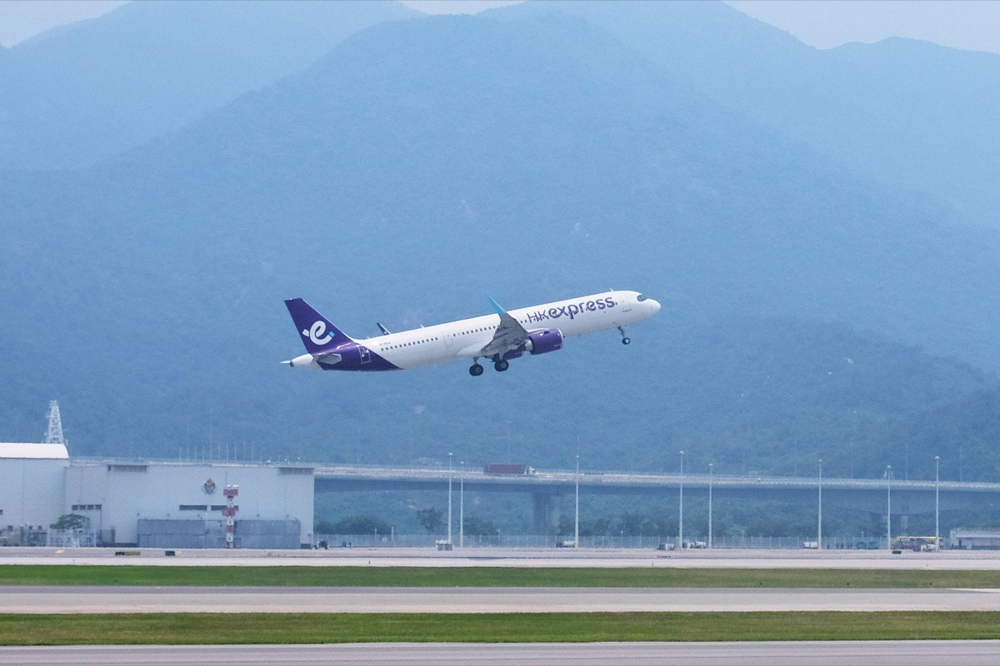

# 國泰再訂 14 架空巴！加購 11 架 A330-900、香港快運 3 架 A321neo，目錄價約 1,669 億台幣，2026 年起要接 120 架新機

**新聞分類：航空資訊／寰宇一家**
**發布日期：2026 年 11 月 12 日**

**國泰集團**在 **11 月 11 日**宣布再訂 **14 架**新飛機：國泰航空行使購買權，**加購 11 架 Airbus A330-900**；香港快運加購 **3 架 A321neo**。加上這批訂單，國泰從 2026 年起的新機交付總數達到 **120 架**。

## 一、訂單重點

| 項目 | 內容 |
| --- | --- |
| 宣布日期 | **2026/11/11** |
| A330-900 | 加購 **11 架**（行使 2024 年訂單的購買權），累計 **41 架** |
| A321neo | 香港快運加購 **3 架**，2023 年已訂 32 架 A321neo／A320neo |
| 合計 | **14 架** |
| 2026 年起新機交付 | 共 **120 架** |
| 投資 | 2026～2035 年承諾投資超過 **1,500 億港元** |
| 長期目標 | 市場條件許可下，10 年內 **150 架新機、150 個航點** |

## 二、11 架 A330-900 的價格與交機

| 項目 | 內容 |
| --- | --- |
| 目錄價（基本價格） | 約 **51.14 億美元** |
| 約合港元 | 約 **398.89 億港元** |
| 約合台幣 | 約 **1,668.6 億元**（1 美元 = 32.6279 元） |
| 實際價格 | 空巴提供**大幅折扣**，國泰獲港交所豁免**不公開** |
| 付款 | 每架分 **8 期**現金支付，前 7 期交機前付清 |
| 交機時間 | **2031～2035 年** |
| 資金 | 商業銀行貸款、融資租賃、售後回租或營運現金 |
| 用途 | **取代現有中型廣體客機**，主要服務**亞洲區域航點**，也保留飛較長航線的彈性 |

_香港快運 A321neo，這次加購 3 架（圖片來源：國泰航空）_

## 三、國泰 2026 年起的新機種類

| 機型 | 用途 |
| --- | --- |
| A320neo、A321neo | 窄體機，香港快運與國泰短程線 |
| **A330-900** | 區域廣體機，累計 41 架 |
| **777-9** | 長程廣體機，將裝新頭等艙 Halo Suites |
| A350F | 貨機 |
| A330 貨機 | 貨機 |

## 四、對台灣旅客的意義

- 台北－香港是國泰的**主要區域航線**之一，A330-900 定位就是取代區域中型廣體機，未來有機會飛到台灣航線，但實際派機要等國泰公告。
- 這批 A330-900 要到 **2031 年**以後才交機，短期內搭不到；2024 年訂的 30 架會先到。
- 香港快運加購 A321neo，主攻中國大陸與短程航線。

## 五、總結

**國泰再訂 14 架空巴：11 架 A330-900（累計 41 架）與 3 架香港快運 A321neo，11 架 A330-900 目錄價約 51.14 億美元（約 1,669 億台幣），2031～2035 年交機。** 國泰 2026 年起要接收 120 架新機，未來十年區域線與長程線都會大幅換新。

### 消息來源

1. 國泰航空：[Cathay continues to invest in the Hong Kong international aviation hub by ordering 14 more new aircraft](https://news.cathaypacific.com/cathay-continues-to-invest-in-the-hong-kong-international-aviation-hub-by-ordering-14-more-new-aircraft)
2. 大紀元時報（香港）：[國泰增購11架空巴A330-900飛機 基本價格約399億元](https://hk.epochtimes.com/news/2026-11-11/3301217)
3. 顏究所：[國泰新頭等艙「Halo Suites」曝光！只裝在 777-9、最快 2027 年底，專利圖可變雙人套房；現有頭等艙只剩 6 架](https://yenlabaero.com/cathay-pacific-halo-suites-first-class-777-9)

_封面照片：國泰航空客機於香港國際機場起飛（國泰航空），經裁切。_

_編輯註：本文整理截至 2026 年 11 月 11 日的資訊，以各公司官方公告為準。_
