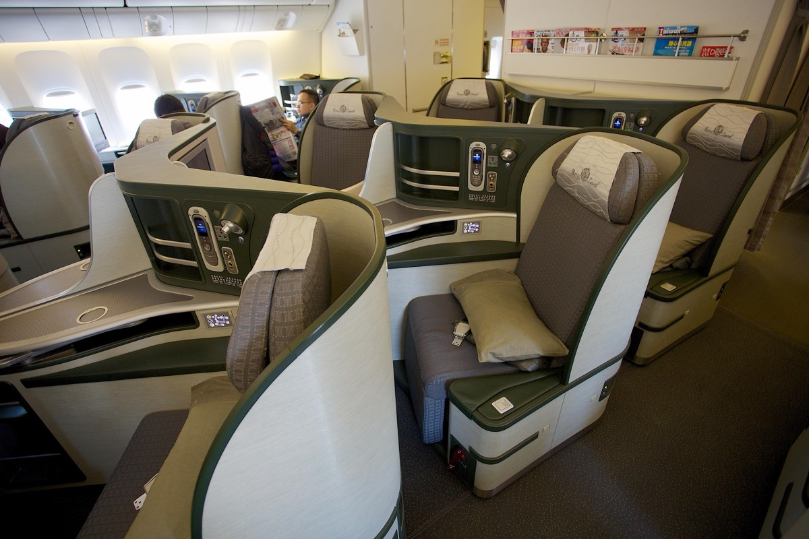

# 長榮商務艙獎勵機位大開！洛杉磯飛台北單程 7.5 萬哩、達拉斯與休士頓 8 萬哩，2027 年 1～10 月都有位

**新聞分類：哩程資訊／星空聯盟**
**發布日期：2026 年 11 月 12 日**

**長榮航空**美國飛台北的**商務艙（皇璽桂冠艙）獎勵機位**目前大量釋出：**洛杉磯飛台北單程 75,000 哩**，**達拉斯、休士頓飛台北 80,000 哩**，日期涵蓋 **2027 年 1 月到 10 月**。

_長榮 777-300ER 皇璽桂冠艙（Edwin Leong／[Wikimedia Commons](https://commons.wikimedia.org/wiki/File:EVA_Air_Royal_Laurel_Class_(12834007415).jpg)，CC BY-SA 2.0，2013 年攝）_

## 一、獎勵機位重點

| 航線 | 艙等 | 哩程（單程） | 日期 |
| --- | --- | --- | --- |
| **洛杉磯（LAX）→ 台北（TPE）** | 商務艙 | **75,000 哩** | 2027 年 1～10 月 |
| **達拉斯（DFW）→ 台北（TPE）** | 商務艙 | **80,000 哩** | 2027 年 1～10 月 |
| **休士頓（IAH）→ 台北（TPE）** | 商務艙 | **80,000 哩** | 2027 年 1～10 月 |

_哩程依距離增加；實際有位日期以長榮官網查詢為準。_

## 二、怎麼兌換？

| 項目 | 內容 |
| --- | --- |
| 兌換計畫 | **長榮無限萬哩遊（Infinity MileageLands）** |
| 額外費用 | **燃油附加費**與稅金另付 |
| 查位工具 | 可先用 Seats.aero 等工具看整段日期的空位 |
| 長榮兌換規則 | 可開口行程、單程兌換，來回票可停留 2 次；只改日期不收費 |

## 三、哩程從哪來？

| 來源 | 說明 |
| --- | --- |
| 自己飛、刷聯名卡 | 台灣有多張長榮聯名卡與銀行點數可轉長榮哩程 |
| 美國信用卡 | Capital One 以 2:1.5、Citi ThankYou 以 1:1 轉入 |
| **買哩程** | 長榮買哩程**最高加贈 50% 到 11/25**，但購買的哩程每次兌換**最多只能占一半** |

以洛杉磯飛台北 75,000 哩為例：最多 37,500 哩可以用買的，**其餘至少 37,500 哩要自己累積**。

## 四、適合誰？

- **在美國唸書、工作，2027 年要回台灣**的人，單程 75,000～80,000 哩就能搭商務艙直飛。
- **從台灣出發去美國、想用哩程回程**的人，可以搭配開口或單程兌換。
- 想用美國銀行點數換長榮商務艙的美國卡友。

## 五、總結

**長榮美國飛台北商務艙獎勵位大開：洛杉磯 75,000 哩、達拉斯與休士頓 80,000 哩，2027 年 1～10 月都有位。** 有長榮哩程的人可以趁位子多時先訂；哩程差一點的話，可以搭配 11/25 前的買哩程加贈補足，但記得買的哩程最多只能付一半。

### 消息來源

1. Upgraded Points：[Award Alert: Business Class to Taiwan From 75K Miles](https://upgradedpoints.com/news/award-alert-us-taipei-business-class/)
2. AwardWallet：[EVA Air Selling Miles With up to a 50% Bonus](https://awardwallet.com/news/airlines/buy-eva-infinity-mileagelands-miles/)

_封面照片：長榮航空 777-300ER（4300streetcar／[Wikimedia Commons](https://commons.wikimedia.org/wiki/File:EVA_Air_Boeing_777-300ER_B-16712_landing_at_Taoyuan_May_2026.jpg)，CC BY 4.0），經裁切。_

_編輯註：本文整理截至 2026 年 11 月 11 日的資訊，以各公司官方公告為準。_
