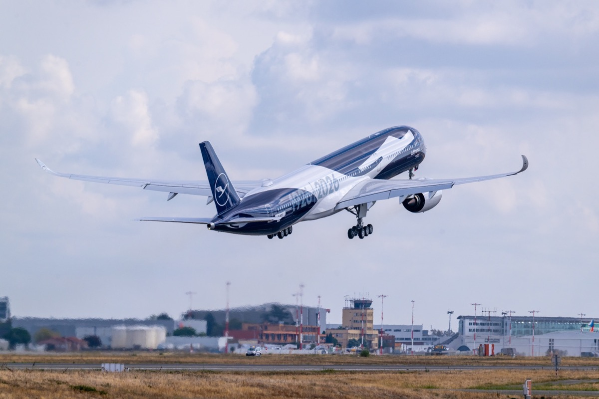
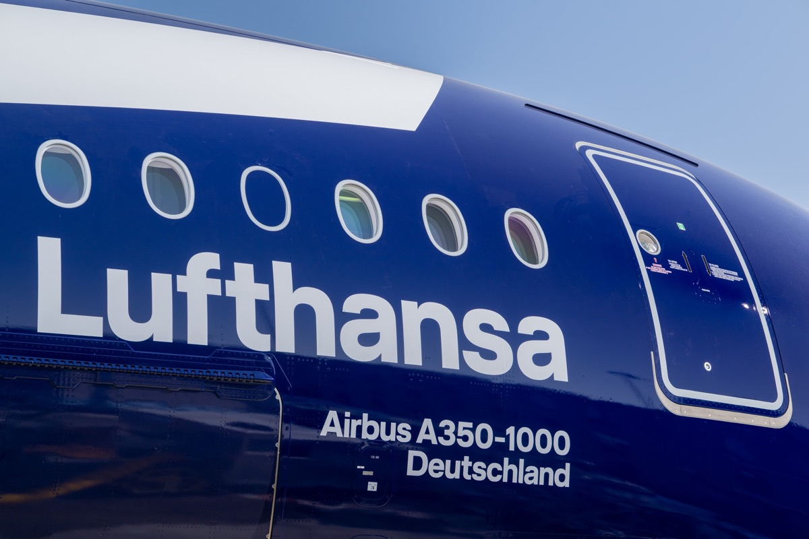
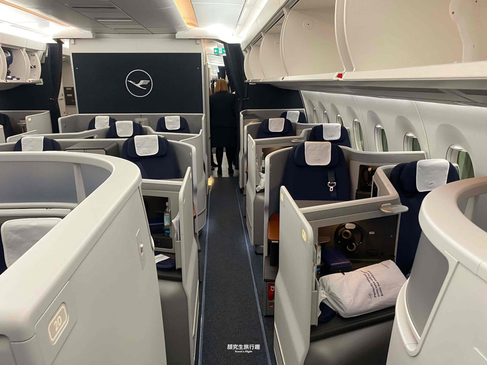
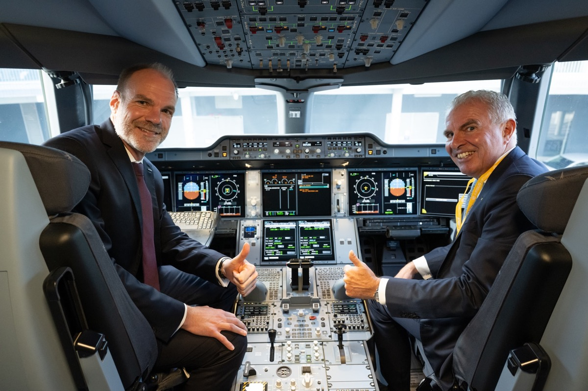

# 【更新】漢莎首架 A350-1000 正式交機！漢莎集團第 700 架空巴，首架裝 Starlink 免費 Wi-Fi 的長程機，12/3 飛東京羽田

**新聞分類：航空資訊／星空聯盟**
**發布日期：2026 年 11 月 12 日**

**漢莎航空首架 Airbus A350-1000** 在 **11 月 10 日**於空巴土魯斯廠正式交機。這架「**Deutschland**」（D-AIFA）是**漢莎集團第 700 架空巴客機**，也是集團**第一架裝 Starlink Wi-Fi 的長程機**。飛機 11 月 11 日飛抵慕尼黑，**12 月 3 日首航慕尼黑－東京羽田**。

> 我們在 10 月 16 日寫過首航航線與座位配置，這篇是交機後的更新，新增 Starlink Wi-Fi、交機進度與美國航點等新資訊。

_A350-1000 D-AIFA 在土魯斯試飛（圖片來源：漢莎航空）_

## 一、交機重點

| 項目 | 內容 |
| --- | --- |
| 交機日期 | **2026/11/10**，空巴土魯斯廠 |
| 機號／名稱 | **D-AIFA**／「Deutschland」 |
| 里程碑 | 漢莎集團**第 700 架**空巴客機；漢莎與空巴合作 **50 週年** |
| 塗裝 | 百年紀念藍色塗裝，漢莎第 **7 架**紀念塗裝機（集齊所有機型） |
| 飛抵慕尼黑 | **2026/11/11** |
| 首航 | **2026/12/3** 慕尼黑 → 東京羽田 |
| 後續交機 | 今年底前再交 **3 架** |
| 總訂單 | **15 架**，2030 年前交齊；前 10 架由漢莎航空營運、以慕尼黑為基地 |
| 油耗 | 每位乘客油耗最多低 **30%** |

_機身上的「Airbus A350-1000 Deutschland」字樣（圖片來源：漢莎航空）_

## 二、新消息：Starlink 免費 Wi-Fi

| 項目 | 內容 |
| --- | --- |
| 服務 | Lufthansa Group Wi-Fi powered by **Starlink** |
| 起始 | **12/3 首航起** |
| 地位 | 漢莎集團**第一架**裝 Starlink 的長程機 |
| 費用 | **Miles & More 會員、Travel ID 用戶免費** |
| 艙等 | **所有艙等**都適用 |
| 速度 | 官方說很多情況比家裡或辦公室網路還快，可看影片、雲端工作 |

_想免費用 Wi-Fi，出發前先註冊 Miles & More 會員（免費）。_

## 三、座位配置：A350-1000 和 A350-900 比較

| 艙等 | A350-1000 | A350-900 | 差異 |
| --- | --- | --- | --- |
| 頭等艙 Allegris | **3～4 席**（2 間單人套房＋1 間雙人 Suite Plus） | 4 席 | － |
| 商務艙 Allegris | **49 席**（其中 8 席套房） | 38 席 | **＋11** |
| 豪華經濟艙 | **35 席** | 24 席 | **＋11** |
| 經濟艙 | **212 席** | 201 席 | ＋11 |
| **合計** | **300 席** | 267 席 | ＋33 |
| 機身長度 | **73.80 公尺** | 66.80 公尺 | ＋7 公尺 |

商務艙和豪華經濟艙座位比 A350-900 多約 **40%**。

_漢莎 A350 的 Allegris 商務艙客艙_

## 四、航線安排

| 航點 | 時間 |
| --- | --- |
| **東京羽田** | **12/3 首航**，初期和 A350-900 輪流飛 |
| 上海浦東 | 東京之後幾週內加入 |
| 新加坡 | 東京之後幾週內加入 |
| 芝加哥、紐華克 | 預計是第一批美國航點，**時間未定** |

_漢莎集團執行長 Carsten Spohr 與空巴民機執行長 Lars Wagner 在交機儀式（圖片來源：漢莎航空）_

## 五、對台灣旅客的意義

- 漢莎沒有飛台灣，但從**東京羽田**飛慕尼黑是台灣旅客經日本轉歐洲的選項之一，12/3 起有機會搭到 A350-1000 的 Allegris 客艙與免費 Starlink Wi-Fi。
- 初期和 A350-900 輪流飛，**想指定機型，訂位前先看座位圖**（A350-1000 商務艙 49 席）。
- 商務艙可以用星空聯盟哩程兌換。

## 六、總結

**漢莎首架 A350-1000 已在 11/10 交機，是集團第 700 架空巴，也是第一架有 Starlink 免費 Wi-Fi 的長程機；12/3 首航慕尼黑－東京羽田，全機 300 席 Allegris 客艙，今年底前還有 3 架。** Miles & More 會員全艙等免費上網，是這次最實用的新消息。

### 消息來源

1. 漢莎集團：[Lufthansa Group, the world's largest Airbus customer, receives its 700th Airbus aircraft](https://newsroom.lufthansagroup.com/en/lufthansa-group-the-worlds-largest-airbus-customer-receives-its-700th-airbus-aircraft/)
2. 漢莎集團：[Lufthansa's first Airbus A350-1000 arrives with a special livery](https://newsroom.lufthansagroup.com/en/lufthansas-first-airbus-a350-1000-arrives-with-a-special-livery/)
3. One Mile at a Time：[Lufthansa's First Airbus A350-1000 Has Arrived](https://onemileatatime.com/news/lufthansa-airbus-a350-1000/)
4. 顏究所：[漢莎航空首架 A350-1000 亮相！12/3 首航慕尼黑－東京羽田，全機 Allegris 新客艙](https://yenlabaero.com/lufthansa-a350-1000-tokyo-haneda-2026)

_封面照片：漢莎首架 A350-1000 交機（漢莎航空），經裁切。_

_編輯註：本文整理截至 2026 年 11 月 11 日的資訊，以各公司官方公告為準。_
