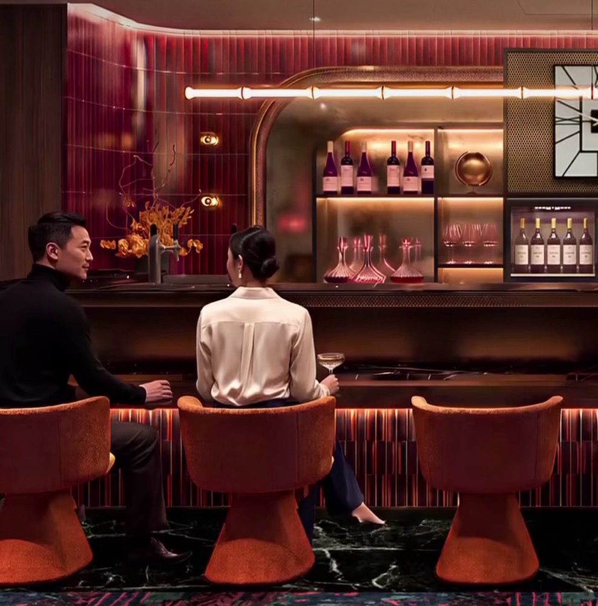

# 香港機場將有入境貴賓室了！環亞 11 月下旬在二號客運大樓開「Rhythms」，主打現場音樂、餐飲與休息空間

**新聞分類：航空資訊／無聯盟**
**發布日期：2026 年 11 月 12 日**

**環亞機場貴賓室（Plaza Premium Lounge）**預計 **2026 年 11 月下旬**在**香港國際機場**開設**入境貴賓室**「**Plaza Premium Lounge – Rhythms**」。開幕後，這會是香港機場**唯一的入境貴賓室**，而且主打的不只是洗澡、吃早餐，還有**現場音樂**。

_Plaza Premium Lounge – Rhythms 示意圖（圖片來源：Plaza Premium Lounge）_

## 一、基本資料

| 項目 | 內容 |
| --- | --- |
| 名稱 | **Plaza Premium Lounge – Rhythms** |
| 開幕 | 預計 **2026 年 11 月下旬** |
| 位置 | **二號客運大樓 3 樓**入境區，**機場快線月台下方** |
| 區域 | **管制區外**（入境後才進得去） |
| 主打 | 餐飲、**現場音樂**、健康體驗、**私人休息空間** |
| 入場方式 | **尚未公布** |

## 二、為什麼值得注意？

| 項目 | 內容 |
| --- | --- |
| 香港入境貴賓室現況 | 目前**沒有**入境貴賓室 |
| 環亞舊入境貴賓室 | 2019 年因機場擴建**關閉**，這次等於重新開設 |
| 國泰入境貴賓室 | **2018 年關閉**，沒有重開計畫 |
| 開幕後 | 香港機場**唯一**的入境貴賓室 |

## 三、和一般入境貴賓室有什麼不同？

| 一般入境貴賓室 | 環亞 Rhythms |
| --- | --- |
| 以**淋浴、早餐**為主 | 餐飲、**現場音樂**、健康、休息空間 |
| 多半只在**早上**營業 | 示意圖看起來偏**晚間酒吧**氛圍，有雞尾酒、葡萄酒 |
| 功能性 | 更像落地後的休閒空間 |

_實際營業時間與服務內容以開幕公告為準。_

## 四、對台灣旅客的意義

- 台北飛香港航程短，入境貴賓室的用途主要是**轉往市區前休息、轉機長時間等待、或晚班抵達後放鬆**。
- 環亞其他貴賓室通常可以用部分信用卡、Priority Pass 或付費進入，但**這間的入場方式還沒公布**，開幕後我們再更新。
- 貴賓室在**管制區外**，從香港轉機不入境的旅客用不到。

## 五、總結

**環亞將在 11 月下旬於香港機場二號客運大樓 3 樓入境區開「Plaza Premium Lounge – Rhythms」，主打餐飲、現場音樂與休息空間，是香港機場唯一入境貴賓室。** 入場方式還沒公布，開幕後再看用信用卡或 Priority Pass 能不能進。

### 消息來源

1. One Mile at a Time：[Plaza Premium Opening Hong Kong Arrivals Lounge… With Live Music?!](https://onemileatatime.com/news/plaza-premium-arrivals-lounge-hong-kong/)
2. Plaza Premium Lounge：[官方 Instagram](https://www.instagram.com/plazapremiumlounge/)

_封面圖：環亞香港入境貴賓室示意圖（Plaza Premium Lounge），經裁切。_

_編輯註：本文整理截至 2026 年 11 月 11 日的資訊，以各公司官方公告為準。_
