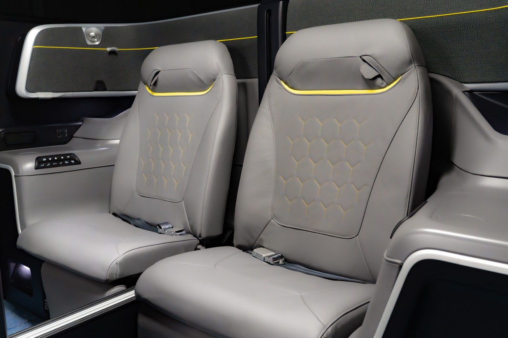
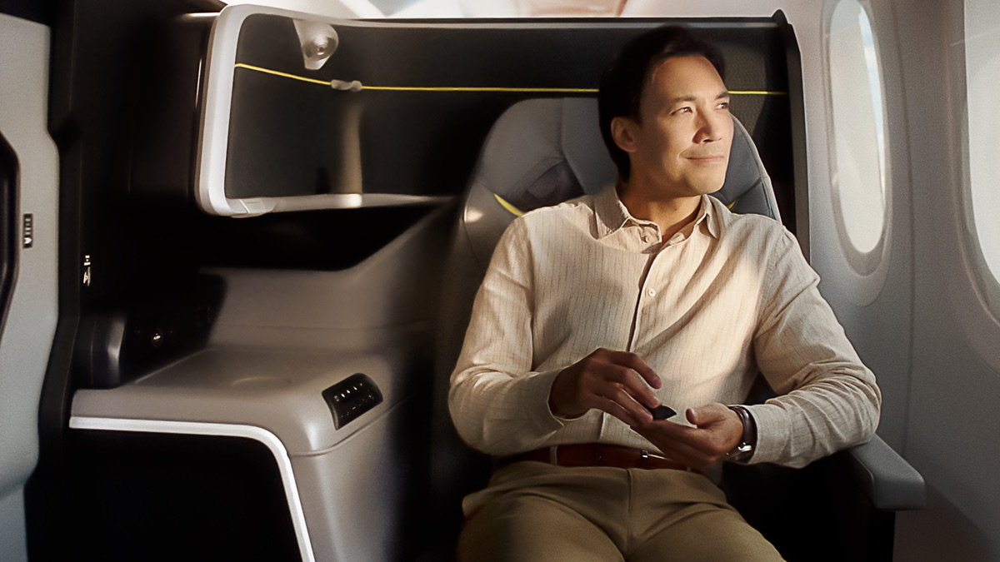

# 新航新商務艙被批像「牙醫椅」！灰黃配色引論戰，新航回應：顏色經過精選、燈光可調，2027 下半年照常上線

**新聞分類：航空資訊／星空聯盟**
**發布日期：2026 年 11 月 12 日**

**新加坡航空** 11 月 6 日發表的**新商務艙**，因為**灰色皮革搭配黃綠色線條**，被旅客與航空評論者批評像「**牙醫椅**」、電競椅，甚至像廉航內裝。新航出面回應，強調配色經過精選，新客艙仍會在 **2027 年下半年**起陸續上線。

_新商務艙中間座位，灰色皮革搭配黃綠色線條（圖片來源：新加坡航空）_

## 一、爭議在哪？

| 項目 | 內容 |
| --- | --- |
| 發表 | **2026/11/6**，總投資超過 **20 億新幣**，涵蓋頭等、商務、豪經、經濟艙 |
| 爭議焦點 | 商務艙**灰色皮革＋黃綠色點綴**、部分**塑膠材質** |
| 批評 | 前新航空服員網紅 Darshen Kuna 在 Instagram 說像**牙醫椅**，建議上線前重新考慮配色 |
| 其他比較 | 被比成新航旗下廉航**酷航**、已停業的 **Spirit 航空** |
| 範圍 | 批評**集中在外觀**，功能面普遍獲得肯定 |

## 二、新航怎麼回應？

| 回應 | 內容 |
| --- | --- |
| 配色 | 設計團隊**精選顏色、材質與表面**，打造現代、精緻的客艙 |
| 燈光 | **LED 燈光可調**，整趟航程的氛圍會跟著改變 |
| 研究 | 超過 **5,000 名**常客、旅客、員工與業界專家參與研究 |
| 後續 | 會持續**收集旅客意見**，用營運經驗優化體驗 |

## 三、新商務艙的功能

| 功能 | 內容 |
| --- | --- |
| 材質 | **全粒面頂級皮革** |
| 隱私 | **滑門** |
| 中間座位 | **電動中間隔板**，可打開成蜜月座 |
| 平躺 | **全平躺** |
| 其他 | 人體工學改良、更大的娛樂螢幕、更好的充電、更寬的腳部空間 |
| 開發 | **RECARO** 座椅、**Designworks** 設計 |
| 上線 | **2027 年下半年**起陸續上線 |

_新商務艙靠窗座位，有滑門（圖片來源：新加坡航空）_

## 四、支持的聲音

實際體驗過的新加坡歌手、網紅也有人稱讚**滑門帶來的隱私**和**更大的空間、人體工學**，認為不該因為配色就否定整體改良。

## 五、總結

**新航新商務艙因灰黃配色被批像牙醫椅，新航回應配色經過精選、LED 燈光可調，功能面有滑門、電動隔板、全粒面皮革，2027 下半年照常上線。** 實際觀感要等上機後才知道，客艙規格可以參考我們 11/7 的完整整理。

### 消息來源

1. Aviation A2Z：[Singapore Airlines Defends S$2 Billion Cabin Unveil After 'Dental Chair' Backlash](https://aviationa2z.com/index.php/2026/11/12/singapore-airlines-defends-2-billion-cabin-unveil-after-dental-chair-backlash/)
2. 顏究所：[新航新頭等、商務艙正式亮相！頭等艙可併成最大雙人床，商務艙有門、坐著就能躺平，但又延到 2027 下半年](https://yenlabaero.com/singapore-airlines-new-cabins-unveiled-2027)

_封面照片：新航新商務艙靠窗座位（新加坡航空），經裁切。_

_編輯註：本文整理截至 2026 年 11 月 12 日的資訊，以各公司官方公告為準。_
