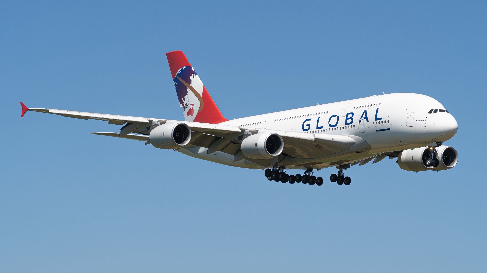

# 全 A380 新創航空 Global Airlines 正式破產清算！只飛過 2 趟來回，唯一一架 A380 停在法國等拆解

**新聞分類：航空資訊／無聯盟**
**發布日期：2026 年 11 月 14 日**

想用 **A380** 重現「航空黃金年代」的英國新創 **Global Airlines** 正式走入清算：英國高等法院在 **2026 年 11 月 4 日**下達**清算令（winding-up order）**，公司交由英國破產署的官方接管人接管。這家航空公司只飛過 **2 趟有付費乘客的來回航班**。

## 一、清算重點

| 項目 | 內容 |
| --- | --- |
| 清算令 | **2026/11/4** 英國高等法院下達，11/11 公開 |
| 聲請人 | 美國債權人，2026/5/29 提出 |
| 先前聲請 | 2025 年 8 月、2026 年 3 月兩次清算聲請都撤回 |
| 接管 | 英國破產署**官方接管人（Official Receiver）** |
| 影響 | 創辦人 James Asquith 與董事會**不再控制公司**，銀行帳戶通常凍結 |
| 接管人工作 | 調查公司與董事行為、處分資產、清償債權人 |
| 翻案機會 | 撤銷申請期限 11/11 已過；上訴通常要在 21 天內提出 |

## 二、Global Airlines 大事記

| 時間 | 事件 |
| --- | --- |
| 2021 年 7 月 | 創辦人 James Asquith 宣布成立 Global Airlines |
| 2023 年 5 月 | 宣布買下第一架 A380（前新航機身），從未投入營運 |
| 2025 年春天 | 以葡萄牙 Hi Fly 的營運執照**濕租**，飛了 **2 趟**歐洲－紐約付費來回 |
| 2025/7/16 | 唯一營運的 A380（9H-GLOBL）停到法國**塔布－盧爾德機場** |
| 2026 年 6 月 | 創辦人仍說 A380 年底前復飛，還要飛英國－馬爾地夫 |
| **2026/11/4** | **法院下達清算令** |

## 三、那架 A380 怎麼辦？

| 項目 | 內容 |
| --- | --- |
| 機號 | **9H-GLOBL** |
| 來歷 | 前**中國南方航空** A380 |
| 狀態 | 停在法國塔布機場，**12 年大檢修已到期** |
| 前景 | 二手 A380 加上大檢修費用，很難找到買家，業界普遍預期**拆解或賣零件** |

_9H-GLOBL 2025 年 7 月降落法國塔布機場（Hugo LUC／Wikimedia Commons，CC BY-SA 4.0）_

## 四、總結

**全 A380 新創航空 Global Airlines 被英國法院下令清算，只飛過 2 趟付費來回，唯一的 A380 停在法國等檢修，外界預期將被拆解。** 這個高調的「A380 黃金年代」計畫，最後沒能真正營運起來。

### 消息來源

1. One Mile at a Time：[Global Airlines Liquidating: The Senseless A380 Dream Finally Dies](https://onemileatatime.com/news/global-airlines-liquidating/)
2. Upgraded Points：[All-A380 Global Airlines Shutting Down After Court Order](https://upgradedpoints.com/news/global-airlines-court-order-liquidation/)

_封面照片：Global Airlines A380（Hugo LUC／[Wikimedia Commons](https://commons.wikimedia.org/wiki/File:Airbus_A380_-_9H-GLOBL_from_Global_Airlines_landing_at_LFBT_airport.jpg)，CC BY-SA 4.0），經裁切；這張就是飛機 2025 年 7 月降落塔布機場、開始長期停放時拍的。_

_編輯註：本文整理截至 2026 年 11 月 13 日的資訊，以各公司官方公告為準。_
