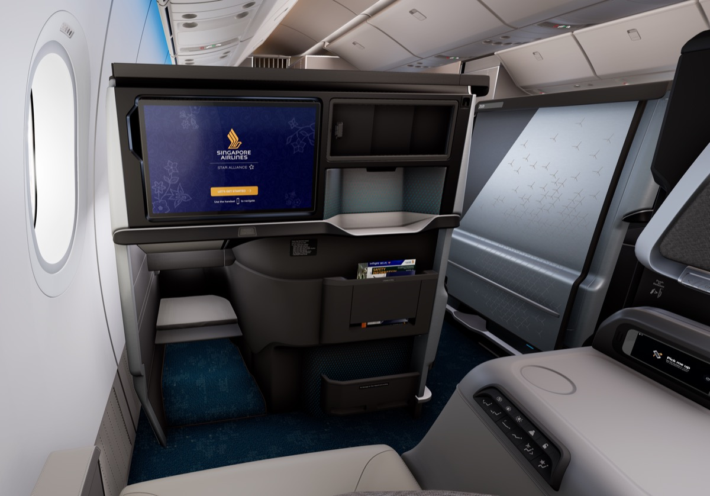

# 【更新】新航執行長回應新商務艙配色爭議：「會研究可行性」！商務長卻說「80/20 法則，不可能討好所有人」

**新聞分類：航空資訊／星空聯盟**
**發布日期：2026 年 11 月 14 日**

**新加坡航空**新商務艙的**灰黃配色**被批評像「牙醫椅」之後，執行長**吳俊鵬（Goh Choon Phong）**首度鬆口：**「我們會研究，看看什麼可行」**。不過新航高層也強調，旅客實際坐過之後會喜歡這張座椅。

> 我們 11 月 12 日寫過「牙醫椅」爭議與新航最初的回應，這篇是後續更新。

_新航新商務艙（圖片來源：新加坡航空）_

## 一、新航高層怎麼說？

| 人物 | 職位 | 說法 |
| --- | --- | --- |
| **吳俊鵬** | 執行長 | 「**我們會研究，看看什麼可行**」；強調旅客體驗座椅的舒適後會喜歡 |
| **李立信** | 商務長 | 這是**很好的學習機會**，希望旅客坐過後不會那麼在意顏色；「**80/20 法則，不可能討好所有人**」 |
| Ong Wah Li | 產品體驗副總裁 | 發表時說設計回應旅客意見，「現代、清新、優雅、適合商務旅行」 |
| Julia de Bono | BMW Designworks 執行長 | 配色「**更清新、更前衛**」，像「**西裝配球鞋**」 |

_執行長發言出自 11/11 的員工大會。_

## 二、時間軸

| 日期 | 事件 |
| --- | --- |
| 11/6 | 新航發表超過 20 億新幣的新客艙 |
| 11/7～11/11 | 商務艙灰黃配色被批像牙醫椅、廉航內裝 |
| 前幾天 | 新航強力辯護，強調顏色經過精選、LED 燈光可調 |
| **11/11** | **執行長在員工大會說會研究可行性** |

## 三、會改嗎？

| 考量 | 說明 |
| --- | --- |
| 鬆口 | 執行長首次表態願意研究 |
| 困難 | 座椅很早就下訂、生產，要改配色**不一定來得及** |
| 時程 | 新客艙預計 **2027 年下半年**起上線 |
| 可能做法 | 外界猜測若要調整，最可能是更換面料或點綴色，但新航沒有說明 |

## 四、總結

**新航執行長吳俊鵬表示會研究調整新商務艙配色的可行性，但商務長以「80/20 法則」回應，座椅也早已下訂，短期內未必改得了。** 2027 下半年上線時是否換色，我們會持續追蹤。

### 消息來源

1. One Mile at a Time：[Singapore Airlines Reconsiders New Business Class Seat Design After Backlash](https://onemileatatime.com/news/singapore-airlines-reconsiders-new-business-class-seat-design-backlash/)
2. 顏究所：[新航新商務艙被批像「牙醫椅」！灰黃配色引論戰，新航回應：顏色經過精選、燈光可調，2027 下半年照常上線](https://yenlabaero.com/singapore-airlines-business-class-dental-chair-criticism-2026)

_封面照片：新航新商務艙中間座位（新加坡航空），經裁切。_

_編輯註：本文整理截至 2026 年 11 月 13 日的資訊，以各公司官方公告為準。_
