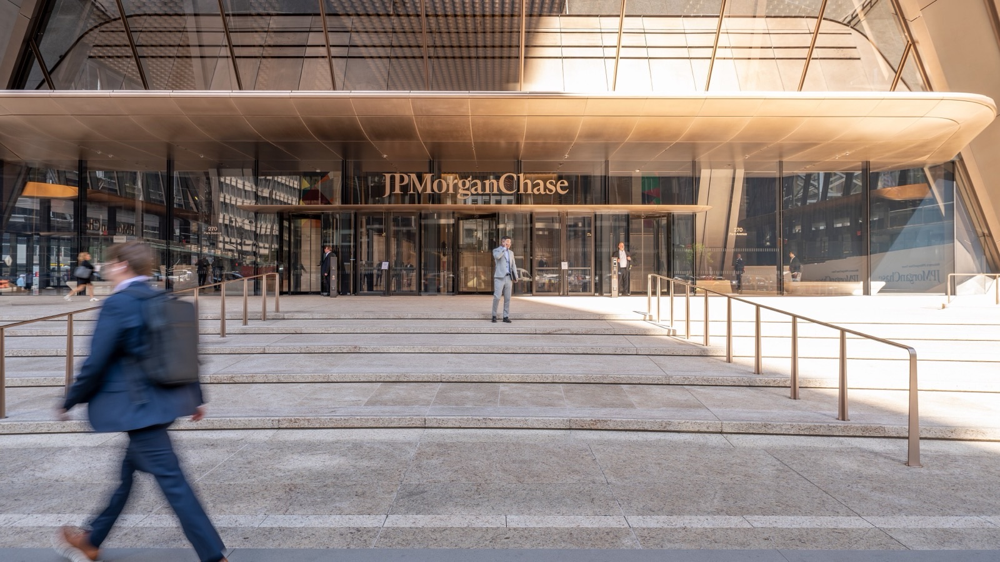

# 摩根大通信用卡掌門人 Allison Beer 離職！任內 Sapphire Reserve 改版、接手 Apple Card，接班人數週內公布

**新聞分類：信用卡／美國信用卡**
**發布日期：2026 年 11 月 15 日**

**摩根大通（JPMorgan Chase）**信用卡業務負責人 **Allison Beer** 將離職，轉往外部機構任職。聯席總裁 **Troy Rohrbaugh** 在 11 月 13 日（美國時間週五）發給員工的備忘錄中說，Beer「告訴我她決定離開公司，接受外部的工作機會」，接班人會在**未來幾週內**公布。

_紐約公園大道 270 號的摩根大通總部（ajay_suresh／Wikimedia Commons，CC BY 4.0）_

## 一、人事重點

| 項目 | 內容 |
| --- | --- |
| 離職者 | **Allison Beer** |
| 職位 | 信用卡與聯網商務（Card Services & Connected Commerce）執行長 |
| 去向 | **外部機構**，尚未公布 |
| 宣布方式 | 聯席總裁 Troy Rohrbaugh 11/13 內部備忘錄 |
| 接班人 | **未來幾週內**任命 |
| 業務規模 | 全球規模最大的信用卡業務之一 |

## 二、Allison Beer 的經歷

| 時間 | 經歷 |
| --- | --- |
| 2017 年以前 | 曾任職**美國運通** |
| **2017 年** | 加入摩根大通 |
| **2021 年 9 月** | 接任 Chase 信用卡業務執行長，接替 Marianne Lake |
| 之後 | 職務擴大為信用卡與聯網商務執行長 |

她任內推出的不少產品，鎖定**旅行者和高消費客群**，直接和老東家美國運通競爭。

## 三、她任內的大事

| 時間 | 事件 |
| --- | --- |
| 2025 年 6 月 | **Sapphire Reserve 大改版**，年費調高到 **795 美元**（約新台幣 25,939 元） |
| 2026 年 1 月 | 摩根大通宣布成為 **Apple Card** 的新發卡行 |
| 2026 年 | Chase Travel 精選飯店 **The Edit** 擴大，2027 年起加入度假屋 |
| 持續 | Sapphire Reserve for Business、IHG 等聯名卡推出高額開卡禮 |

_新台幣以 Mastercard 1 美元 ≈ 32.63 元換算。_

The Edit 加入度假屋可以看 [Chase The Edit 2027 年加入超過 1 萬間度假屋](/chase-the-edit-vacation-homes-2027)，Chase 各卡開卡禮可以看 [Chase 信用卡開卡禮大整理](/chase-credit-card-welcome-bonus-2026)。

## 四、摩根大通高層近期變動

| 時間 | 變動 |
| --- | --- |
| 2026 年 6 月 | 曾被視為執行長接班人選的 Marianne Lake 退休，Doug Petno 與 Troy Rohrbaugh 各身兼兩職 |
| 2026 年 11 月 | 信用卡業務負責人 Allison Beer 離職 |

## 五、對卡友有什麼影響？

- **目前沒有任何權益變動**，Sapphire、聯名卡的權益、點數都照舊。
- 新負責人上任後，**產品策略可能調整**，例如年費、額度型權益、Chase Travel 的方向，值得觀察。
- Beer 會去哪家公司還沒公布，如果去的是競爭對手，未來美國高端信用卡的競爭可能更激烈。
- 這些卡都**只限美國申請**，需要美國信用紀錄。

## 六、總結

**摩根大通信用卡業務負責人 Allison Beer 將離職轉往外部機構，接班人幾週內公布。** 她 2021 年起掌管 Chase 信用卡，任內 Sapphire Reserve 改版、接手 Apple Card。卡友權益目前不受影響，但新負責人上任後的策略方向值得留意。

### 消息來源

1. Bloomberg：[JPMorgan Loses Card Chief Allison Beer to ‘External Opportunity’](https://www.bloomberg.com/news/articles/2026-11-14/jpmorgan-loses-card-chief-allison-beer-to-external-opportunity)
2. Barron's：[JPMorgan’s Top Credit Cards Executive Is Leaving the Bank](https://www.barrons.com/articles/jpmorgan-credit-cards-allison-beer-5f0c928d)
3. TradingView（格隆匯）：[摩根大通信用卡業務負責人艾莉森·比爾將離職](https://tw.tradingview.com/news/gelonghui:32e4ee4d3acdf:0/)
4. 顏究所：[Chase The Edit 2027 年加入超過 1 萬間度假屋](https://yenlabaero.com/chase-the-edit-vacation-homes-2027)
5. 顏究所：[Chase 信用卡開卡禮大整理](https://yenlabaero.com/chase-credit-card-welcome-bonus-2026)

_封面卡面：Chase 官網，顏究所排版。內文照片：紐約公園大道 270 號摩根大通總部（ajay_suresh／[Wikimedia Commons](https://commons.wikimedia.org/wiki/File:JPMorgan_Chase_-_270_Park_Avenue_(55283843744).jpg)，CC BY 4.0）。_

_編輯註：本文整理截至 2026 年 11 月 15 日的資訊，以各公司官方公告為準。_
