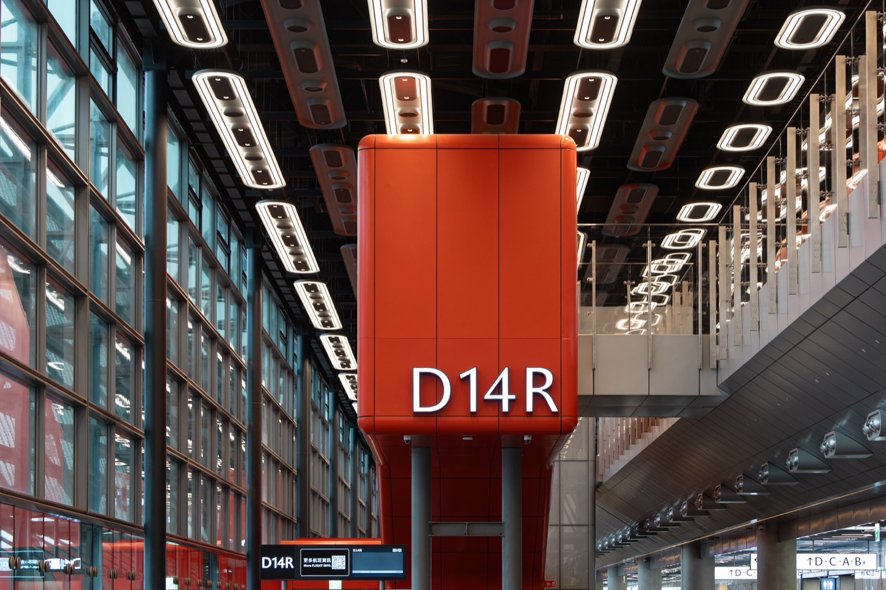

# 桃園機場 6 項免費設施：不用貴賓室也能休息、淋浴、按摩，第三航廈北廊廳有 30 組免費按摩椅

**新聞分類：航空資訊／無聯盟**
**發布日期：2026 年 11 月 20 日**

很多人到桃園機場，過完安檢就坐在登機門滑手機。其實航廈裡有好幾項**完全免費**的設施，不用頂級信用卡、也不用搭商務艙就能用，搭**紅眼班機**或**轉機**的人特別用得到。

## 一、6 項免費設施一覽

| 設施 | 位置 | 重點 |
| --- | --- | --- |
| **機場體驗區** | 第一航廈管制區 **4 樓**，環亞貴賓室旁 | **24 小時**，沙發、USB 插座、淋浴間 |
| **免費淋浴間** | 第一、二航廈**入境區**；第二航廈出境 4 樓 | 有熱水、沐浴用品，**毛巾自備** |
| **按摩椅** | 竹林密境 SPA 區；**第三航廈北廊廳** | 北廊廳有 **30 組**免費按摩椅 |
| **飲水機、充電站** | 各登機門與休憩區 | 冷熱水、USB、Type-C、一般插座 |
| **主題育嬰空間** | 航廈內哺集乳室 | Hello Kitty 主題 |
| **主題展區、電子圖書館** | 霹靂布袋戲展區、電子圖書館 | 候機打發時間 |

## 二、機場體驗區：不用貴賓室也能休息

| 項目 | 內容 |
| --- | --- |
| 位置 | 第一航廈**管制區 4 樓**，環亞機場貴賓室旁 |
| 時間 | **24 小時** |
| 誰能用 | 所有進入管制區的旅客 |
| 設備 | 長桌、個人沙發、長沙發、USB 插座、哺集乳室、淋浴間 |
| 餐點 | **沒有**，可以自己帶 |

## 三、免費淋浴間

| 位置 | 注意 |
| --- | --- |
| 第一、二航廈**入境區**行李轉盤附近 | **要在通過海關前**使用，出海關就回不去 |
| 第二航廈**出境 4 樓** | 出發前可以先洗澡 |
| 機場體驗區內 | 第一航廈管制區 4 樓 |

有熱水和沐浴用品，**毛巾要自己帶**。長途飛行回國想先梳洗再進公司，或搭深夜航班，都很實用。

## 四、免費按摩椅

_桃園機場第三航廈北廊廳（照片：Taiwan Presidential Office／Wikimedia Commons，CC BY 4.0）_

| 地點 | 內容 |
| --- | --- |
| **竹林密境 SPA 按摩區** | 管制區內，到附近免稅店索取代幣，可免費按 15 分鐘 |
| **第三航廈北廊廳** | 開放式候機區有 **30 組**免費按摩椅，可以邊按邊看飛機 |

第三航廈北廊廳 2025 年 12 月啟用，主航廈預計 2027 年底啟用。

## 五、其他免費設施

| 設施 | 說明 |
| --- | --- |
| 飲水機 | 帶空水壺過安檢後免費裝冷熱水 |
| 充電站 | 候機座椅旁、服務台附近，支援 USB、Type-C 與一般插頭 |
| Hello Kitty 主題育嬰空間 | 帶嬰幼兒出國的家長可以利用，也是拍照熱點 |
| 霹靂布袋戲展區 | 第二航廈 D7 登機門附近，展出經典戲偶與科技互動 |
| 電子圖書館 | 免費閱讀電子書報與雜誌 |

## 六、哪些人最用得到？

| 旅客 | 建議 |
| --- | --- |
| 紅眼班機 | 先到機場體驗區休息、淋浴 |
| 長途回國 | 入境過海關前先洗澡 |
| 轉機 | 按摩椅、充電站、電子圖書館打發時間 |
| 帶小孩 | 主題育嬰空間 |
| 搭第三航廈北廊廳航班 | 30 組免費按摩椅 |

設施位置與開放時間可能調整，以桃園機場現場標示為準。

## 七、總結

**桃園機場有 6 類免費設施：第一航廈 4 樓 24 小時機場體驗區、入境與出境的免費淋浴間、竹林密境與第三航廈北廊廳的免費按摩椅、飲水機與充電站、主題育嬰空間，以及霹靂布袋戲展區和電子圖書館。** 搭紅眼班機、轉機或長途回國的人，提早一點到機場就能用好用滿。桃機第三航廈的進度與華航規劃，可以參考[華航法說會重點](/china-airlines-investor-conference-q3-2026)。

### 消息來源

1. 風傳媒：去桃園機場不知道虧大了！「6大隱藏免費服務」很多人沒用過（2026/11/20）
2. 知新聞：第三航廈北登機廊廳開箱！30組免費按摩椅、10家商店進駐（2025/12/1）
3. 中央社：桃機三航廈北廊廳啟用（2025/12/25）
4. 鏡週刊：霹靂布袋戲走進桃園機場 結合經典戲偶、AI科技互動打造主題展演空間（2026/10/22）
5. 顏究所：[華航法說會重點](https://yenlabaero.com/china-airlines-investor-conference-q3-2026)

_封面照片：桃園機場第一航廈出境大廳（Wei-Te Wong／[Wikimedia Commons](https://commons.wikimedia.org/wiki/File:Taoyuan_Airport_T1_Departures_Hall_20221224.jpg)，CC BY-SA 2.0），經裁切。_

_編輯註：本文整理截至 2026 年 11 月 20 日的資訊，以各公司官方公告為準。_
