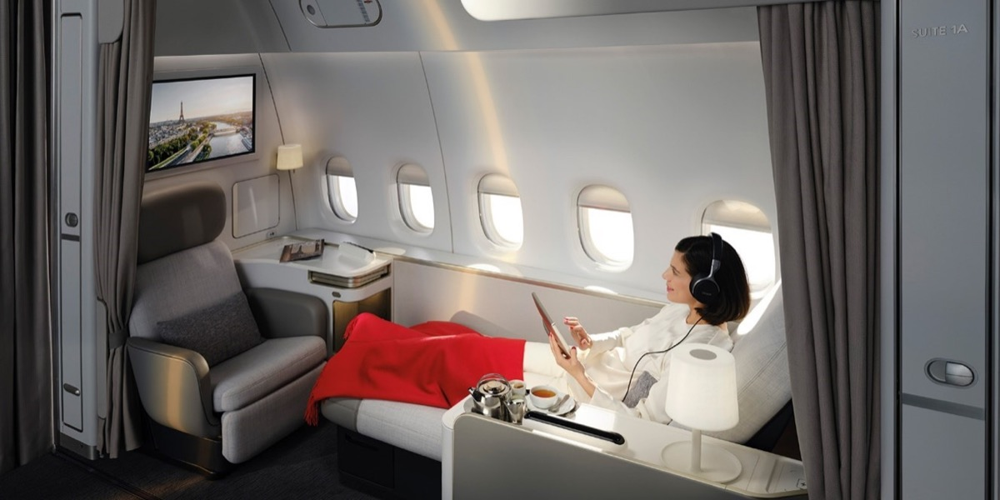

# 法航砸 10 億歐元搶頂級客！La Première 頭等艙有保時捷接送、2 公尺床，巴黎－紐約約 1.4 萬美元起

**新聞分類：航空資訊／天合聯盟**
**發布日期：2026 年 11 月 3 日**

油價上漲、一般旅客縮減旅遊預算，**法國航空**反而把重心放在**最頂端的旅客**。法航的新 **La Première 頭等艙**從**保時捷停機坪接送**、私人安檢，到機上**有 5 扇窗的私人套房**，目標是做出媲美私人飛機的體驗，並計畫**未來 5 年投入 10 億歐元**全面升級服務。

*法航新 La Première 套房（圖片來源：法國航空）*

## 一、套房規格

| 項目 | 內容 |
| --- | --- |
| 機型 | 777-300ER |
| 每架套房數 | 4 間，1-1-1 配置 |
| 窗戶 | 每間 5 扇 |
| 座位 | 獨立座椅，起降、用餐、休息都可調整 |
| 長榻 | 座椅前方的長榻，可以坐著伸腿看書、看電影 |
| 床 | 長榻展開成 **2 公尺**長的床 |
| 隱私 | 從地板到天花板的厚窗簾 |
| 螢幕 | 兩個 **32 吋 4K** 抗眩光螢幕 |
| 耳機 | 降噪耳機，也能用藍牙連自己的耳機 |
| 充電 | 110V／220V 插座、USB-A、USB-C、無線充電 |
| 控制 | 無線觸控平板，控制座椅、燈光、遮光簾 |
| 收納 | 拿掉頭頂行李櫃，改設專屬收納抽屜 |

## 二、地面與機上服務

| 階段 | 服務 |
| --- | --- |
| 機場 | 專屬入口、私人安檢 |
| 貴賓室 | 寬敞的頭等艙貴賓室、SPA 水療、魚子醬與香檳 |
| 登機 | 保時捷休旅車直接送到飛機旁 |
| 機上餐飲 | 米其林三星主廚設計的餐點、精選葡萄酒與香檳 |
| 睡眠 | 設計師品牌睡衣，2 公尺平躺床 |

法航客戶事務執行副總裁表示，搭私人飛機行蹤可能被追蹤，搭一般商業航班的頭等艙反而能「完全隱身」。

## 三、票價

| 航線 | 頭等艙來回票價 |
| --- | --- |
| 巴黎－紐約 | 約 1.4 萬美元起（約新台幣 45 萬元） |
| 美國－法國（其他航線） | 可能超過 2 萬美元 |

法航頭等艙的**哩程兌換**只開放給 Flying Blue 高等級會員，一般會員換不到。

## 四、哪些航線有新套房？

| 航點（往返巴黎戴高樂） | 備註 |
| --- | --- |
| 紐約 JFK | 2025 年春季首航 |
| 洛杉磯 | — |
| 舊金山 | — |
| 波士頓 | 2026 年 11 月 19 日起，波士頓首度有頭等艙 |
| 休士頓 | 2026 年 7 月起 |
| 邁阿密 | 2026 年 11 月 18 日起 |
| 紐華克 | 2027 年 2 月 1 日起 |
| **東京羽田** | 亞洲航點 |
| **新加坡** | 亞洲航點 |
| 阿必尚 | 2026 年 6 月 22 日起，撒哈拉以南非洲首條 |

法航計畫在 19 架 777-300ER 上裝設新套房，服務巴黎出發的 14 個航點。美國新航線詳見〈[法航新 La Première 頭等艙擴大到更多美國航線](/air-france-la-premiere-us-routes-2026)〉。

## 五、為什麼砸錢搶高端客？

| 指標 | 數字 |
| --- | --- |
| 2025 年頭等艙＋商務艙業務 | 成長 28.1% |
| 經濟艙營收 | 停滯 |
| 未來 5 年服務升級投資 | 10 億歐元 |
| 伊朗戰爭以來航空燃油價格 | 翻倍 |

這也反映「**K 型經濟**」：高收入族群受惠股市上漲、消費力強；一般民眾受通膨影響，花錢更謹慎。不只法航，印度航空、英國航空，甚至部分美國廉價航空也在升級高端產品。

## 六、對台灣旅客的意義

- **亞洲也搭得到：** 東京羽田、新加坡都有新套房，從台灣出發可以先飛到東京或新加坡再轉搭。
- **哩程難換：** 頭等艙獎勵機票只給 Flying Blue 高等級會員，大多數人只能買現金票。
- **每班只有 4 個位子：** 機位非常少，想體驗要提早規劃。

## 七、總結

**法航新 La Première 頭等艙每架 777-300ER 只有 4 間套房，各有 5 扇窗、2 公尺長的床、兩個 32 吋螢幕，地面有保時捷接送與私人安檢；巴黎－紐約來回約 1.4 萬美元起。** 法航 2025 年頭等與商務艙業務成長 28.1%，未來 5 年再投入 10 億歐元，亞洲的東京羽田、新加坡也有新套房。

### 消息來源

1. 公視新聞網：[法航打造頂級頭等艙 搶攻金字塔頂端市場](https://news.pts.org.tw/article/833606)（2026/11/2）
2. 法國航空：[Air France launches its new La Première suite in Abidjan](https://corporate.airfrance.com/en/news/air-france-launches-its-new-la-premiere-suite-abidjan)（2026/6/11）
3. Upgraded Points：[Air France Adds New La Première Cabin to More U.S. Flights](https://upgradedpoints.com/news/air-france-new-la-premiere-more-us-flights/)（2026/10/28）

_封面照片：法航 777-300ER 停在巴黎戴高樂機場（4300streetcar／[Wikimedia Commons](https://commons.wikimedia.org/wiki/File:Air_France_Boeing_777-300ER_F-GZNA_at_CDG_May_2025_1.jpg)，CC BY 4.0），經裁切。_

_編輯註：本文整理截至 2026 年 11 月 3 日的資訊，以各公司官方公告為準。_
