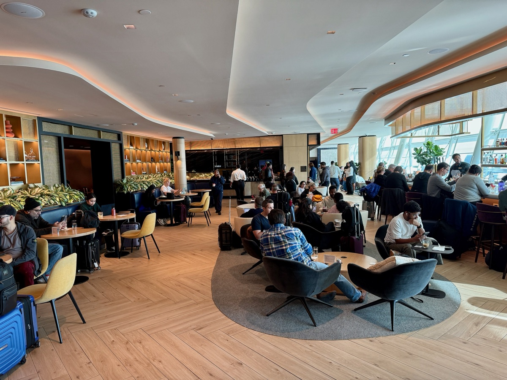

# 全球最佳 Priority Pass 貴賓室前 10 名！維也納機場奪冠，拉斯維加斯 Chase Sapphire 第 3，亞洲只有仁川入榜

**新聞分類：航空資訊／無聯盟**
**發布日期：2026 年 11 月 8 日**

商務信用卡公司 **Capital on Tap** 分析了 **74 間 Priority Pass 貴賓室**，選出全球前 10 名：**維也納機場 VIENNA Lounge** 奪冠，**拉斯維加斯 Chase Sapphire Lounge** 第 3，美國共有 **4 間**進前 10，亞洲只有**仁川機場 Sky Hub Lounge** 入榜。

## 一、怎麼評分？

| 項目 | 說明 |
| --- | --- |
| 樣本 | **74 間** Priority Pass 貴賓室 |
| Priority Pass 會員評分 | 滿分 5 分，**權重最高** |
| 設施數量 | 餐飲、淋浴、Wi-Fi 等設施越多越好 |
| 每週開放時數 | 開越久分數越高 |
| 服裝規定 | **有服裝規定會扣分** |

## 二、全球前 10 名

| 名次 | 貴賓室 | 機場 | 重點 |
| --- | --- | --- | --- |
| 1 | **VIENNA Lounge** | 奧地利維也納 | 總分 **8.73**，會員評分 **4.8**，18 項設施，每週開 122.5 小時 |
| 2 | Goldair Handling Lounge Extra | 希臘雅典（非申根區） | 總分 8.19，評分 4.5，**24 小時**營業，11 項設施 |
| 3 | **Chase Sapphire Lounge by The Club** | 美國拉斯維加斯 | 總分 8.19，評分 **4.7**，15 項設施，每天 04:30～23:00 |
| 4 | IGA Lounge | 土耳其伊斯坦堡 | — |
| 5 | **Virgin Atlantic Clubhouse** | 美國洛杉磯 | 評分 4.4，18 項設施，每週開 101.5 小時 |
| 6 | Prima Vista Lounge | 義大利羅馬 | — |
| 7 | The Club SFO | 美國舊金山 | 評分 4.5，12 項設施，每週開 133 小時 |
| 8 | 土耳其航空貴賓室 | 美國邁阿密 | 評分 4.3，**24 小時**，14 項設施，前 10 名唯一有服裝規定（smart casual） |
| 9 | The View Lounge | 比利時布魯塞爾 | — |
| 10 | **Sky Hub Lounge** | 韓國仁川 | 亞洲唯一入榜 |

_Chase Sapphire Lounge 甘迺迪機場分店內部，拉斯維加斯分店是這次的第 3 名（Oleg Yunakov／Wikimedia Commons，CC BY-SA 4.0）_

## 三、冠軍 VIENNA Lounge 有什麼？

| 項目 | 內容 |
| --- | --- |
| 面積 | 約 **2,500 平方公尺** |
| 設施 | 休息室、**淋浴間**、會議區、可看停機坪的全景視野 |
| 餐飲 | 由奧地利最大民營餐飲公司 **DoN group** 負責，主打在地料理 |
| 藝術 | 和**利奧波德博物館**合作，展示克林姆、席勒、莫澤等維也納現代主義作品的高品質複製畫 |
| 獎項 | **連續 3 年**獲 Priority Pass 卓越獎「**歐洲年度最佳貴賓室**」，是第一個三連霸的機場貴賓室 |
| 人次 | 2025 年 VIENNA Lounge 與 SKY Lounge 合計首度突破 **100 萬**人次 |

## 四、拉斯維加斯 Chase Sapphire Lounge

- 位於哈里瑞德國際機場**第 1 航廈 C 大廳**，美國排名最高。
- 有免費餐飲、私人浴室、高速 Wi-Fi，以及提供免費氣泡酒的**香檳酒廊**。
- 酒單由紐約餐廳 Parcelle 挑選，季節菜單來自名廚張大衛（David Chang）的 **Momofuku** 餐飲集團。
- 每天 **04:30～23:00**，沒有服裝規定。

## 五、對台灣旅客的意義

- **亞洲只有仁川入榜：** 從台灣經首爾轉機的人，可以試試仁川 Sky Hub Lounge。
- **Priority Pass 全球規模：** 超過 1,900 間貴賓室與體驗，分布在 143 國、865 個機場以上。
- 桃園機場東方宇逸貴賓室的主任今年拿下 Priority Pass 年度卓越服務人員獎，可以參考[桃機東方宇逸貴賓室主任獲獎](/taoyuan-airport-lounge-priority-pass-award-2026)；龍騰卡推出自家貴賓室會員，可以參考[龍騰卡 DragonPass 開賣自家貴賓室會員](/dragonpass-lounge-membership-2026)。

## 六、總結

**Capital on Tap 分析 74 間 Priority Pass 貴賓室，維也納 VIENNA Lounge 以 8.73 分奪冠，拉斯維加斯 Chase Sapphire Lounge 第 3，美國 4 間進前 10，亞洲只有仁川 Sky Hub Lounge。** 下次經過這些機場，有 Priority Pass 的人可以排進行程。

### 消息來源

1. 世界新聞網：[全球最佳機場貴賓室排名揭曉 美國4間擠進前10名](https://www.worldjournal.com/wj/story/121617/9864529)（2026/11/8）
2. Your Mileage May Vary：[The World's Best Priority Pass Lounges Were Just Ranked. Four Are In The U.S.](https://yourmileagemayvary.com/2026/07/22/the-worlds-best-priority-pass-lounges-were-just-ranked-four-are-in-the-u-s/)（2026/7/22）
3. 維也納機場：[Historic Hat-trick for the VIENNA Lounge](https://viennaairport.com/jart/prj3/news_press/uploads/db-con_def-uploads/va-news/E-32_2026.pdf)（2026/7/1）
4. 顏究所：[全球只有 3 位！桃機東方宇逸貴賓室主任獲 Priority Pass 年度卓越服務人員獎](https://yenlabaero.com/taoyuan-airport-lounge-priority-pass-award-2026)（2026/10/31）
5. 顏究所：[龍騰卡 DragonPass 開賣自家貴賓室會員！年費 59 英鎊起含 2 次，正面挑戰 Priority Pass](https://yenlabaero.com/dragonpass-lounge-membership-2026)（2026/10/25）

_封面照片：紐約甘迺迪機場第 4 航廈的 Chase Sapphire Lounge 入口（ajay_suresh／[Wikimedia Commons](https://commons.wikimedia.org/wiki/File:Chase_Sapphire_Lounge_-_JFK_Terminal_4_(54984999499).jpg)，CC BY 4.0），經裁切。內文照片：甘迺迪機場 Chase Sapphire Lounge 內部（Oleg Yunakov／[Wikimedia Commons](https://commons.wikimedia.org/wiki/File:JFK_Chase_Sapphire_Lounge_-_01.jpg)，CC BY-SA 4.0）。_

_編輯註：本文整理截至 2026 年 11 月 8 日的資訊，以各公司官方公告為準。_
